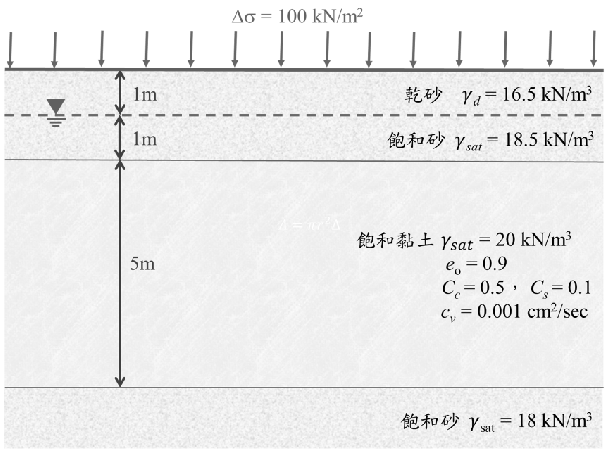

# SM-2021-2 題目正本

> 本檔只記錄**考卷上寫了什麼、圖上畫了什麼**，不含任何解法。解析見同資料夾 `SM-2021-2.md`。
> 判讀清單已確認（凍結）；本檔原則上不再修改（改動須回考卷原圖並記 log）。

| 項目 | 內容 |
|------|------|
| 考卷 | `raw/exams/SM-2021_土壤力學與基礎設計.pdf` 第 2 頁，第二題 |
| 考年 | 民國 110 年（2021） |
| 配分 | 25 分 |
| 附圖 | `SM-2021-2-fig-2.png`（土壤剖面；2026-11-15 由考卷重新擷取 500 dpi）；既有 `SM-2021-2-fig-1.png` 為同一圖，黏土層內有滑鼠游標，保留不刪 |
| 判讀狀態 | **已確認**（2026-11-15 關卡一：使用者授權依建議判讀確認；轉錄 2026-11-15；PyMuPDF 110 dpi 全頁目視，附圖 300 dpi、局部 600 dpi；文字層核對；盲讀後才比對既有解析） |

## 1. 考卷原文（逐字）

> 二、有一土壤剖面如下圖所示，由距離地表面 2 m 深度開始，有一厚度為 5 m 之黏土層，此黏土層為正常壓密黏土。現於地表面施加均勻分布的應力 100 kN/m²，請計算：（25 分）
> ㈠黏土層之主要壓密沉陷量；
> ㈡施加應力 1 個月後、2 個月後、3 個月後所得到之壓密沉陷量分別為何？
> ㈢施加應力多少天後可以得到 50 cm 的壓密沉陷量？
> 註：
> For U = 0 to 60%，$T_v=\dfrac{\pi}{4}\left(\dfrac{U\%}{100}\right)^2$
> For U > 60%，$T_v=1.781-0.933\cdot\log(100-U\%)$

## 2. 考卷給的公式、附表與參數

- 公式（照錄於 §1 註；與 Terzaghi 近似式相同，無筆誤）。
- 圖上參數：$\Delta\sigma$ = 100 kN/m²（地表均布）；乾砂 $\gamma_d$ = 16.5 kN/m³（0～1 m）；飽和砂 $\gamma_{sat}$ = 18.5 kN/m³（1～2 m）；飽和黏土 $\gamma_{sat}$ = 20 kN/m³、$e_o$ = 0.9、$C_c$ = 0.5、$C_s$ = 0.1、$c_v$ = 0.001 cm²/sec（2～7 m）；其下飽和砂 $\gamma_{sat}$ = 18 kN/m³。
- **沒有給**：$\gamma_w$、一個月的天數、黏土預壓密應力（題文已說正常壓密）。
- 卷首注意事項：㈠可以使用電子計算器。㈡不必抄題，作答時請將試題題號及答案依照順序寫在試卷上，於本試題上作答者，不予計分。㈢本科目除專門名詞或數理公式外，應使用本國文字作答。

## 3. 附圖

圖面文字照錄：`Δσ = 100 kN/m²`、`1m`、`乾砂 γd = 16.5 kN/m³`、`1m`、`飽和砂 γsat = 18.5 kN/m³`、`5m`、`飽和黏土 γsat = 20 kN/m³`、`eo = 0.9`、`Cc = 0.5， Cs = 0.1`、`cv = 0.001 cm²/sec`、`飽和砂 γsat = 18 kN/m³`。（黏土層中央另有一行極淡的殘留字「A = πr²Δ」，600 dpi 才看得出，與本題無關。）

## 4. 判讀清單

| # | 項目 | 判讀 | 圖上／題文依據 | 把握 |
|---|------|------|---------------|------|
| 1 | 一個月的天數 | 考卷未定；以 30 天計 | — | 不確定（解讀；影響答案數值，使用者授權依建議定案：建議 30 天） |
| 2 | 地層 | 乾砂 0～1 m、飽和砂 1～2 m、飽和黏土 2～7 m、其下飽和砂 | 圖左側三條尺寸線，端點對齊各層界線；題文「由距離地表面 2 m 深度開始…厚度為 5 m」 | 確定 |
| 3 | 地下水位 | 地表下 1 m（虛線與 ▽ 在第一條 1 m 尺寸線下端） | 圖 300 dpi | 確定 |
| 4 | 排水 | 黏土上下皆為砂 → 雙向排水，$H_{dr}$ = 2.5 m | 圖上黏土下方為飽和砂 | 確定 |
| 5 | 荷重 | 地表均布 100 kN/m²，大面積一維，黏土各深度 $\Delta\sigma$ = 100 | 題文、圖上箭頭布滿地表 | 確定 |
| 6 | 壓密狀態 | 正常壓密 → 只用 $C_c$；$C_s$ = 0.1 為多給的參數 | 題文 | 確定（解讀） |
| 7 | 沉陷計算 | 以黏土層中點（地表下 4.5 m）單層計算 | 考題慣例 | 確定（解讀） |
| 8 | 所求㈢ | 達到 50 cm 沉陷所需天數 | 題文 | 確定 |
| 9 | 考卷沒有給 | $\gamma_w$（取 9.81）、一個月的天數 | 全題 | 確定 |

---

*轉錄：2026-11-15（SM-U1-3 題目正本推廣・批 2）*

*確認：2026-11-15 使用者授權依建議判讀確認（SM-U1-3 題目正本推廣・批 2，關卡一；使用者指示「要確認的依你建議」）*
