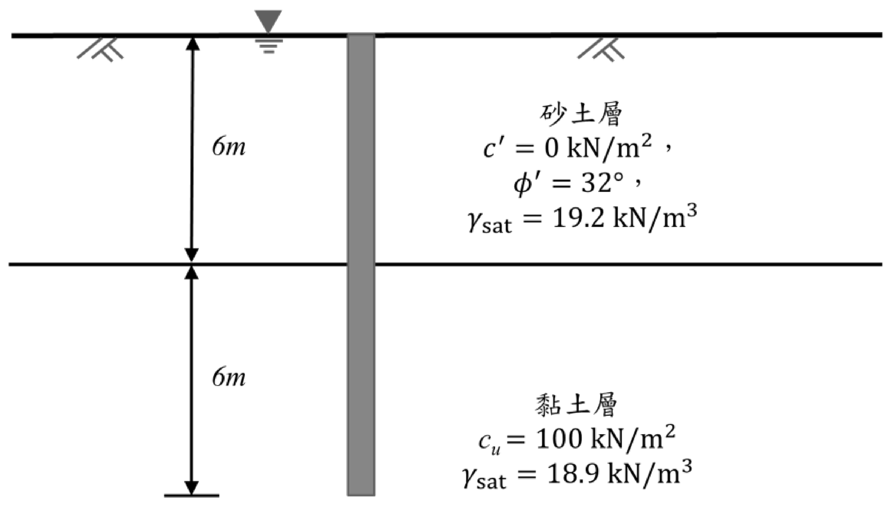

# SM-2021-3 題目正本

> 本檔只記錄**考卷上寫了什麼、圖上畫了什麼**，不含任何解法。解析見同資料夾 `SM-2021-3.md`。
> 判讀清單已確認（凍結）；本檔原則上不再修改（改動須回考卷原圖並記 log）。

| 項目 | 內容 |
|------|------|
| 考卷 | `raw/exams/SM-2021_土壤力學與基礎設計.pdf` 第 3 頁（頁次 4－3），第三題 |
| 考年 | 民國 110 年（2021） |
| 配分 | 25 分 |
| 附圖 | `SM-2021-3-fig-2.png`（地層與基樁剖面；2026-11-15 由考卷重新擷取 500 dpi）；既有 `SM-2021-3-fig-1.png` 為同一圖，砂土層參數右側有滑鼠游標，保留不刪 |
| 判讀狀態 | **已確認**（2026-11-15 關卡一：使用者授權依建議判讀確認；轉錄 2026-11-15；PyMuPDF 110 dpi 全頁目視，附圖 500 dpi 局部放大（內嵌點陣影像兩張上下拼接，bbox (91.9, 316.6)–(503.3, 551.8)）；盲讀後才比對既有解析） |

## 1. 考卷原文（逐字）

> 三、有一長度 12 m，直徑 60 cm 之圓形預鑄混凝土基樁，如下圖所示，貫入於 6 m 厚之砂土層及其下之黏土層中，地下水位於地表面。已知砂土層之 $c'$ = 0 kN/m²，$\phi'$ = 32°，$\gamma_{sat}$ = 19.2 kN/m³，而黏土層之 $c_u$ = 100 kN/m²，$\gamma_{sat}$ = 18.9 kN/m³。使用安全係數 FS = 3 進行下列計算：（25 分）
> ㈠請計算此基樁之容許垂直支承力；
> ㈡請計算此基樁之容許拉拔力。
> 註：1.假設此基樁之側向土壓力係數 $K$ = 1.4 $K_o$。
> 2.假設砂土-混凝土基樁之摩擦角 $\delta'$ = 0.8 $\phi'$。
> 3.於考慮基樁表面附著力時，α 值假設為 0.65。
> 4.於 $\phi$ = 0° 時，假設基樁承載值因數 $N_C^*$ = 9。
> 5.混凝土基樁單位重 = 24 kN/m³。

## 2. 考卷給的公式、附表與參數

- 基樁：圓形預鑄混凝土，長 12 m、直徑 60 cm，單位重 24 kN/m³。
- 砂土層（0～6 m）：$c'$ = 0、$\phi'$ = 32°、$\gamma_{sat}$ = 19.2 kN/m³。
- 黏土層（6 m 以下）：$c_u$ = 100 kN/m²、$\gamma_{sat}$ = 18.9 kN/m³。
- 地下水位於地表面；FS = 3。
- 註：$K = 1.4K_o$；$\delta' = 0.8\phi'$；α = 0.65；$\phi = 0$ 時 $N_c^*$ = 9。
- **沒有給**：$K_o$ 的公式、$\gamma_w$、臨界深度、樁自重在垂直支承力與拉拔力中如何計入、拉拔時是否計樁底阻抗。
- 卷首注意事項：可以使用電子計算器。不必抄題，作答時請將試題題號及答案依照順序寫在試卷上，於本試題上作答者，不予計分。本科目除專門名詞或數理公式外，應使用本國文字作答。

## 3. 附圖

圖面文字照錄：`6m`、`6m`、`砂土層`、`c′ = 0 kN/m²，`、`ϕ′ = 32°，`、`γsat = 19.2 kN/m³`、`黏土層`、`cu = 100 kN/m²`、`γsat = 18.9 kN/m³`。

## 4. 判讀清單

| # | 項目 | 判讀 | 圖上／題文依據 | 把握 |
|---|------|------|---------------|------|
| 1 | 樁自重的計入方式 | 考卷給單位重 24 → ㈡拉拔：容許拉拔力 = 樁身摩擦/FS ＋ 樁有效自重（水位在地表，用 24−γw）；㈠垂直：容許支承力 = (Qp+Qs)/FS，不另扣樁自重 | 註 5 給單位重但未說用法 | 不確定（影響答案）；使用者授權依建議確認 |
| 2 | $K_o$ | 考卷沒給公式；用 Jaky 式 $K_o = 1-\sin\phi'$ | 註 1 | 確定（解讀） |
| 3 | 地層與樁長 | 砂土 0～6 m、黏土 6～12 m（樁底在黏土中，黏土厚度向下延伸未標） | 附圖左側兩段 6m 尺寸線，下段下端橫線與樁底同高 | 確定 |
| 4 | 樁頭位置 | 樁頂齊地表 | 附圖灰色樁頂與地表線同高 | 確定 |
| 5 | 地下水位 | 地表（附圖水位符號在地表） | 題文與附圖 | 確定 |
| 6 | 臨界深度 | 考卷沒提；砂土只有 6 m（10D = 6 m），砂土段的 $\sigma'_v$ 直接隨深度線性計算 | 題文未提臨界深度 | 確定（解讀） |
| 7 | 樁底承載 | 樁底在黏土，$Q_p = 9c_uA_p$ | 註 4 | 確定 |
| 8 | 拉拔時樁底 | 拉拔不計樁底阻抗（吸力） | 一般慣例；題文未提 | 確定（解讀） |
| 9 | 所求 | ㈠容許垂直支承力；㈡容許拉拔力；FS = 3 | 題文 | 確定 |
| 10 | 考卷沒有給 | $K_o$ 公式、$\gamma_w$、臨界深度、自重用法 | 全題 | 確定 |

---

*轉錄：2026-11-15（SM-U2-2 題目正本推廣・批 1）*

*確認：2026-11-15 使用者授權依建議判讀確認（SM-U2-2 題目正本推廣・批 1，關卡一；使用者指示「要我確認的請依你建議」）*
