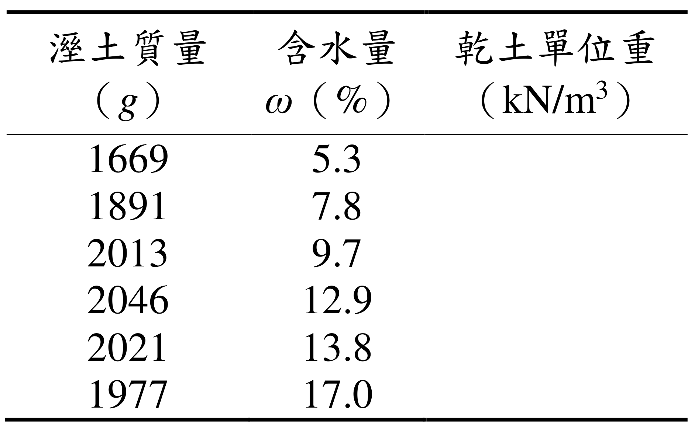

# SM-2022-1 題目正本

> 本檔只記錄**考卷上寫了什麼、圖上畫了什麼**，不含任何解法。解析見同資料夾 `SM-2022-1.md`。
> 判讀清單已確認（凍結）；本檔原則上不再修改（改動須回考卷原圖並記 log）。

| 項目 | 內容 |
|------|------|
| 考卷 | `raw/exams/SM-2022_土壤力學與基礎設計.pdf` 第 1 頁，第一題 |
| 考年 | 民國 111 年（2022） |
| 配分 | 25 分（㈠5、㈡5、㈢5＋10） |
| 附圖 | `SM-2022-1-fig-2.png`（試驗結果表；2026-11-15 由考卷重新擷取 500 dpi）；既有 `SM-2022-1-fig-1.png` 為同一表，左上角有文字游標，保留不刪 |
| 判讀狀態 | **已確認**（2026-11-15 關卡一：使用者授權依建議判讀確認；轉錄 2026-11-15；PyMuPDF 110 dpi 全頁目視，表格 500 dpi；文字層核對；盲讀後才比對既有解析） |

## 1. 考卷原文（逐字）

> 一、請回答下列關於夯實試驗的問題：
> ㈠請敘明土壤夯實的原理。（5 分）
> ㈡標準夯實試驗模具體積為 1000 cm³ 時，請依下表實驗結果繪製標準夯實曲線圖，並標明最大乾單位重及最佳含水量值。（5 分）
> ㈢請敘明影響夯實能量的相關參數，（5 分）若夯實能量增加對夯實曲線、最佳含水量及最大乾單位重的影響為何？（10 分）

## 2. 考卷給的公式、附表與參數

- 試驗結果（照錄；「乾土單位重」欄考卷留空）：

| 溼土質量（g） | 含水量 ω（%） | 乾土單位重（kN/m³） |
|---|---|---|
| 1669 | 5.3 | |
| 1891 | 7.8 | |
| 2013 | 9.7 | |
| 2046 | 12.9 | |
| 2021 | 13.8 | |
| 1977 | 17.0 | |

- 模具體積 1000 cm³（標準夯實）。
- **沒有給**：重力加速度／$\gamma_w$、$G_s$（零空氣孔隙曲線）。
- 卷首注意事項：㈠可以使用電子計算器。㈡不必抄題，作答時請將試題題號及答案依照順序寫在試卷上，於本試題上作答者，不予計分。㈢本科目除專門名詞或數理公式外，應使用本國文字作答。

## 3. 附圖

## 4. 判讀清單

| # | 項目 | 判讀 | 圖上／題文依據 | 把握 |
|---|------|------|---------------|------|
| 1 | 乾土單位重欄 | 考卷留空，須由溼土質量、模具體積、含水量換算（題目要考生填） | 表 | 確定 |
| 2 | 質量→重量 | 考卷未給 $g$；取 9.81 m/s² | — | 確定（解讀） |
| 3 | 溼土質量 | 為模具內土樣質量（不含模具） | 表頭「溼土質量」 | 確定（解讀） |
| 4 | 數據 | 6 組，含水量 5.3～17.0% | 表 500 dpi | 確定 |
| 5 | 所求 | ㈠夯實原理；㈡繪曲線並標 $\gamma_{dmax}$、OMC；㈢影響夯實能量的參數，以及能量增加對曲線、OMC、$\gamma_{dmax}$ 的影響 | 題文 | 確定 |
| 6 | 考卷沒有給 | $g$、$G_s$ | 全題 | 確定 |

---

*轉錄：2026-11-15（SM-U1-3 題目正本推廣・批 2）*

*確認：2026-11-15 使用者授權依建議判讀確認（SM-U1-3 題目正本推廣・批 2，關卡一；使用者指示「要確認的依你建議」）*
