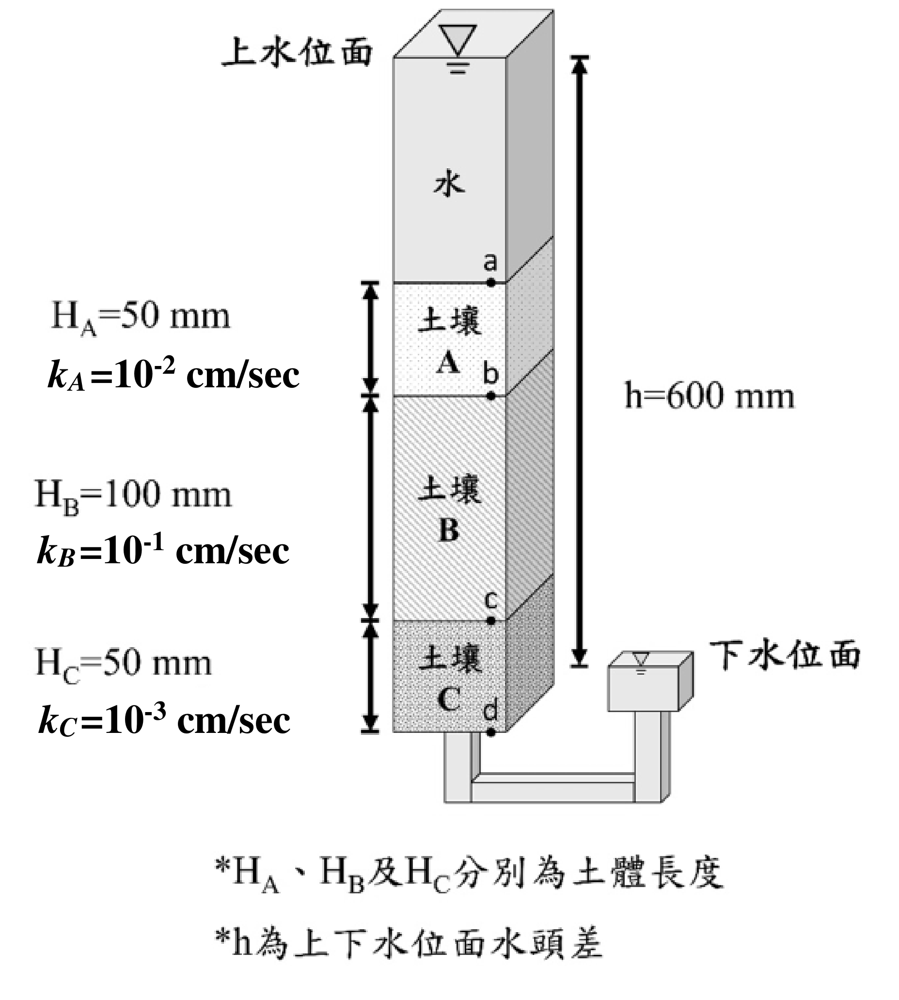

# SM-2022-3 題目正本

> 本檔只記錄**考卷上寫了什麼、圖上畫了什麼**，不含任何解法。解析見同資料夾 `SM-2022-3.md`。
> 判讀清單已確認（凍結）；本檔原則上不再修改（改動須回考卷原圖並記 log）。

| 項目 | 內容 |
|------|------|
| 考卷 | `raw/exams/SM-2022_土壤力學與基礎設計.pdf` 第 2 頁（頁次 4－2），第三題 |
| 考年 | 民國 111 年（2022） |
| 配分 | 25 分（水頭 15 分、流量 10 分） |
| 附圖 | `SM-2022-3-fig-2.png`（三層土柱滲透裝置；2026-11-15 由考卷重新擷取 500 dpi）；既有 `SM-2022-3-fig-1.png` 為同一圖，土壤 C 上帶文字游標，保留不刪 |
| 判讀狀態 | **已確認**（2026-11-15 關卡一：使用者授權依建議判讀確認；轉錄 2026-11-15；PyMuPDF 110 dpi 全頁目視，附圖 400–500 dpi 局部放大（內嵌點陣影像）；PDF 文字層核對逐字原文；盲讀後才比對既有解析） |

## 1. 考卷原文（逐字）

> 三、如下圖上、下水位面水頭差 600 mm，流經 A、B、C 三種土壤（斷面 50 mm × 50 mm，高度分別為 HA = 50 mm、HB = 100 mm、HC = 50 mm），滲透係數分別為 10⁻² cm/sec、10⁻¹ cm/sec、10⁻³ cm/sec，若以下水位面處為基準，請問 a、b、c、d 四個位置的水頭高各是多少 mm？（15 分）並計算 5 小時後的總流量 Q 是多少立方公尺？（10 分）

## 2. 考卷給的公式、附表與參數

- 相關公式（照錄）：
  $$K_{v(eq)} = \frac{H}{\sum_{i=1}^{n}\dfrac{H_i}{K_i}}$$
  其中，$H$ 為土層厚度；$K$ 為土層滲透係數。
- 水頭差 $h$ = 600 mm；斷面 50 mm × 50 mm；$H_A$ = 50 mm、$H_B$ = 100 mm、$H_C$ = 50 mm；$k_A = 10^{-2}$、$k_B = 10^{-1}$、$k_C = 10^{-3}$ cm/sec。
- 圖下註記：「\*HA、HB及HC分別為土體長度」「\*h為上下水位面水頭差」。
- **沒有給**：下水位面與 d 點（或土柱各點）的高差、連通管尺寸。
- 卷首注意事項：㈠可以使用電子計算器。㈡不必抄題，作答時請將試題題號及答案依照順序寫在試卷上，於本試題上作答者，不予計分。㈢本科目除專門名詞或數理公式外，應使用本國文字作答。

## 3. 附圖

圖面文字照錄：`上水位面`、`水`、`a`、`HA=50 mm`、`kA=10⁻² cm/sec`、`土壤 A`、`b`、`HB=100 mm`、`kB=10⁻¹ cm/sec`、`土壤 B`、`c`、`HC=50 mm`、`kC=10⁻³ cm/sec`、`土壤 C`、`d`、`h=600 mm`、`下水位面`、`*HA、HB及HC分別為土體長度`、`*h為上下水位面水頭差`。

## 4. 判讀清單

| # | 項目 | 判讀 | 圖上／題文依據 | 把握 |
|---|------|------|---------------|------|
| 1 | 「水頭高」 | 指**總水頭**（以下水位面為基準 0） | 題文「以下水位面處為基準」 | 確定（解讀） |
| 2 | 下水位面高度 | 畫在土壤 C 範圍內（c 與 d 之間），**不與 d 點切齊**；考卷未標其與 d 的高差 | 附圖 400 dpi：下水位面 ▽ 與 h 尺寸線下端在 c、d 之間 | 確定 |
| 3 | 流向 | 由上而下：上水位面 → a → A → b → B → c → C → d → 連通管 → 下水位面 | 附圖 | 確定 |
| 4 | 點位 | a＝水／土壤 A 交界、b＝A／B 交界、c＝B／C 交界、d＝土壤 C 底面 | 附圖實心點 | 確定 |
| 5 | 層厚與 $k$ | $H_A$ = 50、$H_B$ = 100、$H_C$ = 50 mm；$k_A = 10^{-2}$、$k_B = 10^{-1}$、$k_C = 10^{-3}$ cm/sec（尺寸線兩端對齊各層上下界） | 題文；附圖左側尺寸線 | 確定 |
| 6 | 水頭差 | $h$ = 600 mm，上水位面到下水位面 | 附圖右側尺寸線；圖註 | 確定 |
| 7 | 水柱與連通管 | 土柱上方水柱、柱底連通管內不計水頭損失 | 附圖（無其他阻抗） | 確定（解讀） |
| 8 | 斷面 | 50 mm × 50 mm，三層相同 | 題文 | 確定 |
| 9 | 所求流量 | 穩態下 5 小時累積的總流量 $Q$（m³） | 題文 | 確定 |
| 10 | 考卷沒有給 | 下水位面與 d 的高差（只問總水頭時不需要） | 全題 | 確定 |

---

*轉錄：2026-11-15（SM-U1-2 題目正本推廣・批 1）*

*確認：2026-11-15 使用者授權依建議判讀確認（SM-U1-2 題目正本推廣・批 1，關卡一；使用者指示「要我確認的請依你建議」）*
