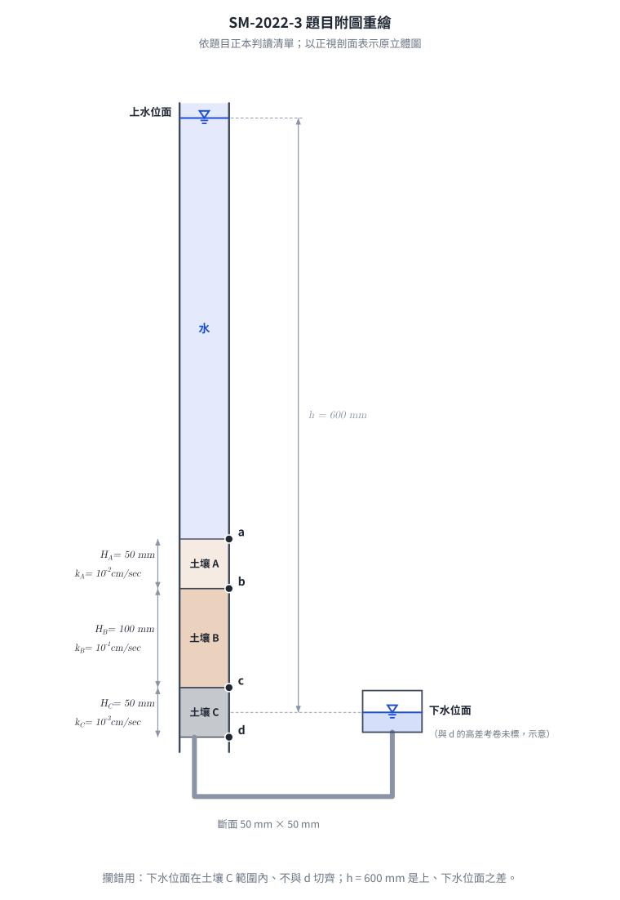
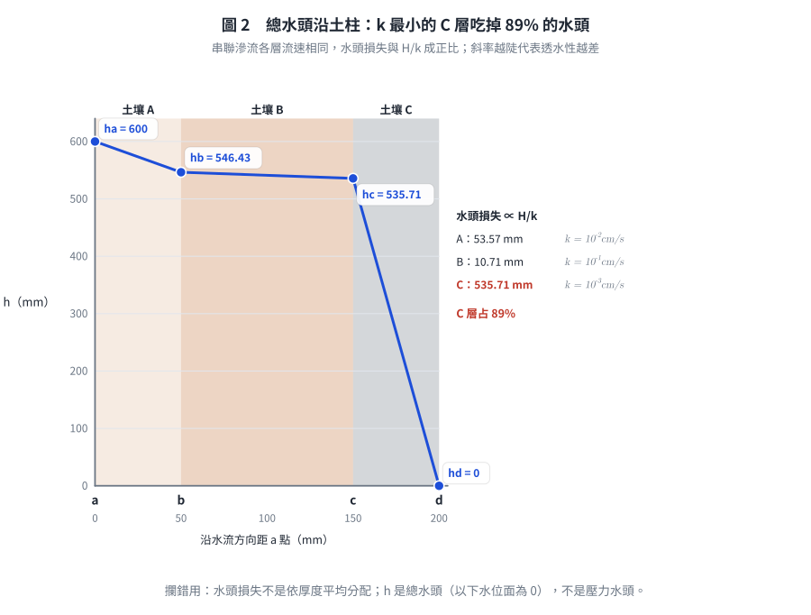

# 考題編號：SM-2022-3

**主分類：** `SM-U1-2` 土壤滲透
**副分類：** 無
**分析法：** 有效應力法
**標籤：** `Darcy定律` `滲透係數` `等效滲透係數` `水頭損失` `總水頭` `層狀土壤滲流`
---

## 1. 題目（考卷原文見題目正本）

> 考卷原文、公式／附表、附圖與判讀清單（已確認）見 [`SM-2022-3-problem.md`](SM-2022-3-problem.md)。本節只列解題時最容易讀錯的地方與本解使用的記號；題意以題目正本為準。

*重繪自考卷附圖，依題目正本判讀清單 #2–#7；攔下的判讀錯誤：下水位面在土壤 C 範圍內、不與 d 切齊（高差考卷未標，圖中示意）。*

### 常見誤讀

| 項目 | 正確判讀 | 常見誤讀 |
|---|---|---|
| 水頭高 | 指總水頭，以下水位面為基準 0（題目正本 #1） | 答壓力水頭或高度水頭 |
| 下水位面 | 在土壤 C 範圍內，**不與 d 切齊**，考卷未標高差（#2） | 舊 §1 寫成「與 d 點切齊」 |
| d 點總水頭 | d 經連通管接下水位面，管內不計損失，總水頭為 0（#7） | 誤把 d 點高程當基準 0 去算壓力水頭 |
| 流量 | 穩態下 5 小時累積的總流量（#9） | 只算單位時間流量 |

**本解記號：** $\Delta h_i$ 各層水頭損失；$R_i=H_i/k_i$ 各層阻抗；$k_{eq}$ 等效滲透係數；$q$ 單位時間流量；$Q$ 5 小時總流量。

## 2. 考題核心精神與出題者意圖 (Core Concepts & Examiner's Intent)
本題測驗層狀土壤（垂直滲流）的等效滲透特性與水頭變化。出題者的意圖在於確認考生是否理解：
1. **連續方程式（達西定律）**：在垂直層狀系統中，流經各土層的流速 $v$ 或流量 $q$ 均為定值。
2. **水頭分布計算**：總水頭損失 $\Delta h$ 會依據各土層的「滲透阻力（厚度除以滲透係數，即 $H_i/k_i$）」成正比分配。
3. **單位換算與細心度**：各土層滲透係數單位為 cm/s，長度單位為 mm，總流量要求為 $\text{m}^3$，考驗計算時單位的統一與轉換。

## 3. 解題戰略地圖與陷阱分析 (Strategic Roadmap & Trap Analysis)
- **第一步：統一單位**
  將長度統一轉換為 cm 或 mm，此處建議將滲透阻力分析的比值以相同的數量級表示，最後將流速或總流量轉為最終要求的單位（$\text{m}^3$）。
- **第二步：分配水頭損失**
  因為 $v = k_i \cdot (\Delta h_i / H_i)$ 為定值，可得 $\Delta h_i \propto H_i / k_i$。
  計算 $H_A/k_A$、$H_B/k_B$、$H_C/k_C$ 的比例關係，並將總水頭差 $600\text{ mm}$ 依比例分配給 A、B、C 三層，求出各層的水頭損失。
- **第三步：計算各點水頭**
  基準面為下水位面；d 點經連通管與下水位面相通（管內不計損失），所以 $h_d = 0\text{ mm}$。
  逆推上去或從頂部 $h_a = 600\text{ mm}$ 往下扣除各層水頭損失，求出 $h_c$、$h_b$、$h_a$。
- **第四步：計算總流量**
  先求出系統等效流速 $v$，或直接用任一土層的公式 $v = k_A \cdot i_A$。再乘上截面積 $A$ 得到單位時間流量 $q$。
  最後將 $q$ 乘上 5 小時（轉為秒），並將體積換算成 $\text{m}^3$。

**陷阱分析**：
- **單位錯亂**：滲透係數使用 cm/sec，長寬、水頭使用 mm，最後要求 $\text{m}^3$，稍有不慎極易計算錯誤。
- **水頭定義**：水頭高通常指「總水頭（Total Head）」。需注意基準為下水位面（d 點總水頭為 0，但 d 點高程考卷未標）。

## 3.5 變數層次分析 (Variable Hierarchy Analysis)

### 最終目標
計算層狀土壤系統中各介面的總水頭大小，以及歷時 5 小時的總滲流量。

### 本題關鍵公式（依計算順序）
$$ k_{eq} = \frac{H_{total}}{\sum \frac{H_i}{k_i}} $$
$$ i = \frac{\Delta h}{H_{total}} $$
$$ v = \boxed{k_{eq}} \cdot \boxed{i} $$
$$ \Delta h_i = \frac{\boxed{v} \cdot H_i}{k_i} $$
$$ h_j = h_{j-1} - \boxed{\Delta h_{i-1}} $$
$$ Q = \boxed{v} \cdot A \cdot t $$

### L1：題目直接給定
| 符號 | 數值 | 說明 |
|---|---|---|
| $\Delta h$ | $600\text{ mm}$ | 總水頭差 |
| $H_A$ | $50\text{ mm}$ | A層土壤厚度 |
| $H_B$ | $100\text{ mm}$ | B層土壤厚度 |
| $H_C$ | $50\text{ mm}$ | C層土壤厚度 |
| $k_A$ | $10^{-2}\text{ cm/s}$ | A層滲透係數 |
| $k_B$ | $10^{-1}\text{ cm/s}$ | B層滲透係數 |
| $k_C$ | $10^{-3}\text{ cm/s}$ | C層滲透係數 |
| $A$ | $50 \times 50\text{ mm}^2$ | 土壤斷面積 |
| $t$ | $5\text{ hours}$ | 滲流時間 |

### L2：需知識點推導
**水頭損失與總水頭分布**
| 符號 | 公式／來源 | 卡關? |
|---|---|---|
| $\Delta h_i$ | $\Delta h \times \frac{H_i/k_i}{\sum (H/k)}$ | |
| $h_i$ | 由基準點向上疊加或向下扣減 | |

**等效流速與總滲流量**
| 符號 | 公式／來源 | 卡關? |
|---|---|---|
| $v$ | $k_i \cdot \frac{\Delta h_i}{H_i}$ | |
| $q$ | $v \cdot A$ | |
| $Q$ | $q \cdot t$ | |

### L3：深層知識（不懂就卡住）
| 知識點 | 說明 | 卡關? |
|---|---|---|
| 垂直層狀滲流特性 | 連續方程式：通過各土層之流速 $v$ 及流量 $q$ 均相同。 | |
| 單位換算 | $1\text{ cm}^3 = 10^{-6}\text{ m}^3$；$1\text{ hour} = 3600\text{ s}$。 | |

## 4. 步驟化詳細計算過程 (Step-by-Step Detailed Calculation)

### Step 1: 分析各土層滲透阻力與水頭損失比例
因流速 $v$ 在垂直系統中為常數，根據達西定律 $v = k_i \cdot i_i = k_i \cdot \frac{\Delta h_i}{H_i}$，可推導出各層的水頭損失 $\Delta h_i$ 與 $\frac{H_i}{k_i}$ 成正比。
為了避免單位混淆，計算 $\frac{H_i}{k_i}$ 時，將 $H_i$ 代入 $\text{mm}$，$k_i$ 代入 $\text{cm/s}$，雖單位不一致但比例關係不變：
- A 層：$R_A = \frac{H_A}{k_A} = \frac{50}{10^{-2}} = 5000$
- B 層：$R_B = \frac{H_B}{k_B} = \frac{100}{10^{-1}} = 1000$
- C 層：$R_C = \frac{H_C}{k_C} = \frac{50}{10^{-3}} = 50000$

阻力總和 $\Sigma R = R_A + R_B + R_C = 5000 + 1000 + 50000 = 56000$

### Step 2: 計算各土層之水頭損失
總水頭差 $\Delta h = 600\text{ mm}$。依比例分配水頭損失：
- $\Delta h_A = \Delta h \times \frac{R_A}{\Sigma R} = 600 \times \frac{5000}{56000} = 600 \times \frac{5}{56} = \frac{3000}{56} = \frac{375}{7} \approx 53.57\text{ mm}$
- $\Delta h_B = \Delta h \times \frac{R_B}{\Sigma R} = 600 \times \frac{1000}{56000} = 600 \times \frac{1}{56} = \frac{600}{56} = \frac{75}{7} \approx 10.71\text{ mm}$
- $\Delta h_C = \Delta h \times \frac{R_C}{\Sigma R} = 600 \times \frac{50000}{56000} = 600 \times \frac{50}{56} = \frac{30000}{56} = \frac{3750}{7} \approx 535.71\text{ mm}$

*(驗算：$\Delta h_A + \Delta h_B + \Delta h_C = \frac{375}{7} + \frac{75}{7} + \frac{3750}{7} = \frac{4200}{7} = 600\text{ mm}$)*

### Step 3: 計算 a、b、c、d 各點總水頭
依題目「以下水位面處為基準」，d 點經連通管接到下水位面、管內不計水頭損失，故 d 點之總水頭為 0。
水流由 a 流向 d，因此：
- $h_d = \boxed{0\text{ mm}}$
- $h_c = h_d + \Delta h_C = 0 + \frac{3750}{7} = \boxed{\frac{3750}{7}\text{ mm} \approx 535.71\text{ mm}}$
- $h_b = h_c + \Delta h_B = \frac{3750}{7} + \frac{75}{7} = \frac{3825}{7} = \boxed{\frac{3825}{7}\text{ mm} \approx 546.43\text{ mm}}$
- $h_a = h_b + \Delta h_A = \frac{3825}{7} + \frac{375}{7} = \frac{4200}{7} = \boxed{600\text{ mm}}$

*(此結果亦符合「上水位面與 d 點之水頭差為 600 mm」之題意)*

*圖 2　串聯滲流的水頭損失與 $H/k$ 成正比，k 最小的 C 層斜率最陡、吃掉 89% 的水頭。攔下「依厚度平均分配水頭損失」與「把總水頭當壓力水頭」的錯誤。*

### Step 4: 計算歷時 5 小時後的總流量 Q
先求取流速 $v$。利用 A 層的水頭損失與參數（將長度單位統一為 cm）：
- $H_A = 50\text{ mm} = 5\text{ cm}$
- $\Delta h_A = \frac{375}{7}\text{ mm} = \frac{37.5}{7}\text{ cm} = \frac{75}{14}\text{ cm}$
- $v = k_A \cdot \frac{\Delta h_A}{H_A} = 10^{-2} \times \frac{75/14}{5} = 10^{-2} \times \frac{15}{14} = \frac{15}{1400} = \frac{3}{280} \text{ cm/s}$

計算斷面積 $A$：
- $A = 50\text{ mm} \times 50\text{ mm} = 5\text{ cm} \times 5\text{ cm} = 25\text{ cm}^2$

計算單位時間流量 $q$：
- $q = v \cdot A = \frac{3}{280} \times 25 = \frac{75}{280} = \frac{15}{56} \text{ cm}^3/\text{s}$

計算 5 小時總流量 $Q$：
- $t = 5\text{ hours} = 5 \times 3600 = 18000\text{ s}$
- $Q = q \cdot t = \frac{15}{56} \times 18000 = \frac{270000}{56} = \frac{33750}{7} \text{ cm}^3 \approx 4821.43\text{ cm}^3$

將單位換算為立方公尺 ($\text{m}^3$)：
- $1\text{ m}^3 = 10^6\text{ cm}^3$
- $Q = \frac{33750 / 7}{10^6}\text{ m}^3 = \frac{3375}{700000}\text{ m}^3 = \frac{27}{5600}\text{ m}^3 = \boxed{0.0048214\text{ m}^3}$

## 5. 關鍵爭議點與進階探討 (Critical Issues & Advanced Discussion)
- **水頭之定義與呈現**：土壤力學中考量滲透時，未指明「水頭」通常即指「總水頭 (Total Head)」。考卷未標 d 點與下水位面的高差（題目正本 #2：下水位面畫在土壤 C 範圍內、不與 d 切齊），故本解不列各點的位置水頭與壓力水頭；題目問的是總水頭，答總水頭即滿足題意。
- **作答精度建議**：對於無法除盡的分數，建議在計算過程中保留分數型態，至最後一步再取至小數點後第 2~4 位，可避免捨入誤差累積。

*修正日期：2026-11-15（§1 改為指向題目正本 `SM-2022-3-problem.md`，重繪附圖 figs/SM-2022-3-fig-1-problem.svg；刪除考卷沒有的「下水位面與 d 點切齊」及其 §3–§5 引申（答案不變）；§4 Step 3 補解題圖解 figs/SM-2022-3-fig-2-head.svg；非勘誤）*
