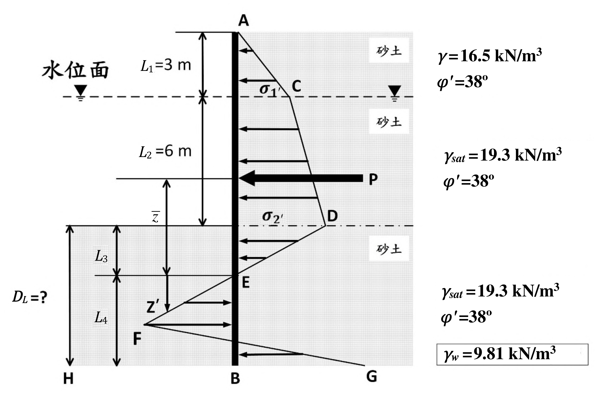

# SM-2022-4 題目正本

> 本檔只記錄**考卷上寫了什麼、圖上畫了什麼**，不含任何解法。解析見同資料夾 `SM-2022-4.md`。
> 判讀清單已確認（凍結）；本檔原則上不再修改（改動須回考卷原圖並記 log）。

| 項目 | 內容 |
|------|------|
| 考卷 | `raw/exams/SM-2022_土壤力學與基礎設計.pdf` 第 3–4 頁（頁次 4－3、4－4），第四題 |
| 考年 | 民國 111 年（2022） |
| 配分 | 25 分 |
| 附圖 | `SM-2022-4-fig-2.png`（懸臂鋼板樁土壓力圖；2026-11-15 由考卷重新擷取 500 dpi）；既有 `SM-2022-4-fig-1.png` 為同一圖，左側水位面標註下方有滑鼠游標，保留不刪 |
| 判讀狀態 | **已確認**（2026-11-15 關卡一：使用者授權依建議判讀確認；轉錄 2026-11-15；PyMuPDF 110 dpi 全頁目視，附圖 350–500 dpi 局部放大（內嵌點陣影像 1249×831）；公式 220 dpi；PDF 文字層核對逐字原文；盲讀後才比對既有解析） |

## 1. 考卷原文（逐字）

> 四、請計算下圖中鋼板樁貫入至砂土層時，在安全係數為 1 時的最小臨界深度 $D_L$。（25 分）

## 2. 考卷給的公式、附表與參數

考卷給的「相關公式」（照錄）：

$$K_a=\tan^2\left(45-\frac{\varphi'}{2}\right)\qquad K_p=\tan^2\left(45+\frac{\varphi'}{2}\right)$$

$$\sigma'_a=\left[\gamma L_1+\gamma' L_2+(z-L_1-L_2)\gamma'\right]K_a$$

$$\sigma'_p=(z-L_1-L_2)\gamma' K_a$$

（照考卷原文；被動土壓應乘 $K_p$，考卷印成 $K_a$。）

$$\sigma'=\sigma'_2-\gamma'(z-L)(K_p-K_a)$$

$$(L_4)^4+A_1(L_4)^3-A_2(L_4)^2-A_3(L_4)-A_4=0$$

其中

$$A_1=\frac{(\gamma L_1+\gamma' L_2)K_p+\gamma' L_3(K_p-K_a)}{\gamma'(K_p-K_a)}\qquad A_2=\frac{8P}{\gamma'(K_p-K_a)}$$

$$A_3=\frac{6P\left[\gamma'(K_p-K_a)(2\bar z+L_3)+(\gamma L_1+\gamma' L_2)K_p\right]}{\left[\gamma'(K_p-K_a)\right]^2}$$

$$A_4=\frac{P\left[6\bar z(\gamma L_1+\gamma' L_2)K_p+6\bar z\gamma' L_3(K_p-K_a)+4P\right]}{\left[\gamma'(K_p-K_a)\right]^2}$$

「其中，$P$ 為之面積；$L$、$\bar z$、$L_3$ 及 $L_4$ 請參閱圖說」（照考卷原文；「為」與「之」之間缺字，依圖應為壓力圖 ACDE 的面積）。

- 圖上參數：水位面以上砂土 $\gamma$ = 16.5 kN/m³、$\varphi'$ = 38°；水位面以下砂土 $\gamma_{sat}$ = 19.3 kN/m³、$\varphi'$ = 38°（開挖線上下兩層相同）；$\gamma_w$ = 9.81 kN/m³；$L_1$ = 3 m、$L_2$ = 6 m。
- **沒有給**：$L$ 的定義文字（依公式為 $L_1+L_2$）、牆面摩擦角、地表超載。
- 卷首注意事項（第 1 頁）：㈠可以使用電子計算器。㈡不必抄題，作答時請將試題題號及答案依照順序寫在試卷上，於本試題上作答者，不予計分。㈢本科目除專門名詞或數理公式外，應使用本國文字作答。

## 3. 附圖

圖面文字照錄：`A`、`水位面`、`L1=3 m`、`σ1'`、`C`、`砂土`、`γ=16.5 kN/m3`、`φ'=38°`、`L2 =6 m`、`P`、`γsat =19.3 kN/m3`、`φ'=38°`、`z̄`、`σ2'`、`D`、`L3`、`E`、`DL =?`、`Z'`、`L4`、`F`、`H`、`B`、`G`、`γw =9.81 kN/m3`。

## 4. 判讀清單

| # | 項目 | 判讀 | 圖上／題文依據 | 把握 |
|---|------|------|---------------|------|
| 1 | 水位面 | 地表下 $L_1$ = 3 m，背側與開挖側同一水位（虛線跨越兩側）→ 兩側淨水壓為零 | 附圖 350 dpi，虛線由左延伸到右，兩側皆有水位符號 | 確定 |
| 2 | 開挖線 | 地表下 $L_1+L_2$ = 9 m（點鏈線 D 高程）；開挖側地面在此 | 附圖 L2 尺寸線下端 | 確定 |
| 3 | $D_L$ | 開挖線到樁底 B：$D_L = L_3+L_4$（尺寸線 H 端對齊樁底） | 附圖左側尺寸線 | 確定 |
| 4 | $L_3$、E 點 | 開挖線到淨壓力為零的 E 點 | 附圖 L3 尺寸線 | 確定 |
| 5 | $P$、$\bar z$ | $P$ 為淨壓力圖 ACDE 的面積（單位寬度合力），$\bar z$ 為 $P$ 作用點到 E 的距離（尺寸線上端對齊 P、下端對齊 E） | 附圖；考卷「P 為之面積」缺字 | 確定（解讀） |
| 6 | 土層 | 全為砂土 $\varphi'$ = 38°；水位以上 $\gamma$ = 16.5、以下 $\gamma_{sat}$ = 19.3（開挖線以下同） | 附圖右側參數 | 確定 |
| 7 | 考卷公式筆誤 | $\sigma'_p$ 式印成乘 $K_a$，應為 $K_p$；其餘 $A_1$～$A_4$ 與 Das 懸臂板樁砂土公式一致 | 公式頁 220 dpi | 確定 |
| 8 | 安全係數 | FS = 1（題文），不折減 $K_p$、不加長 | 題文 | 確定 |
| 9 | 所求 | 最小臨界深度 $D_L$（m） | 題文 | 確定 |
| 10 | 考卷沒有給 | 牆面摩擦角（採 Rankine）、地表超載、$L$ 的文字定義 | 全題 | 確定 |

---

*轉錄：2026-11-15（SM-U2-3 題目正本推廣・批 1）*

*確認：2026-11-15 使用者授權依建議判讀確認（SM-U2-3 題目正本推廣・批 1，關卡一；使用者指示「要我確認的請依你建議」）*
