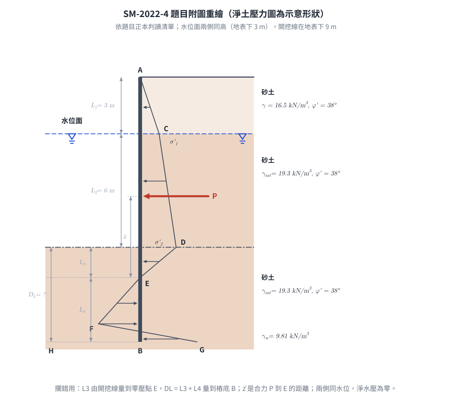
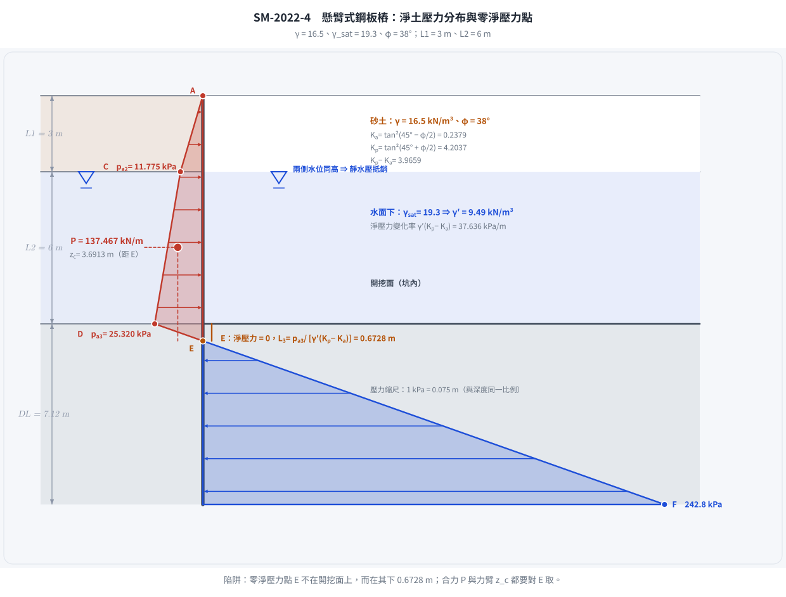
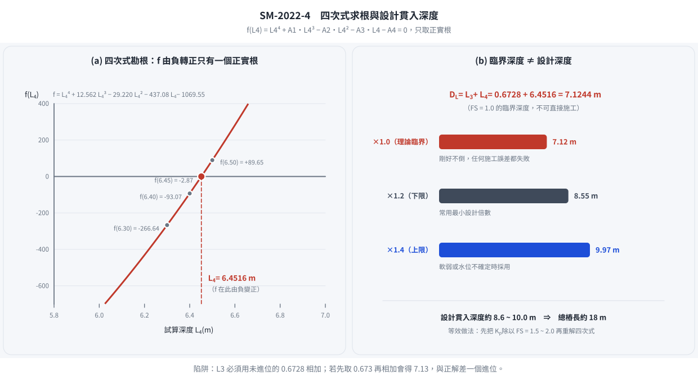

# 考題編號：SM-2022-4

**主分類：** `SM-U2-3` 開挖之穩定性分析
**副分類：** `SM-U3-1` 側向土壓力理論
**分析法：** 有效應力法
**標籤：** `板樁` `開挖穩定性` `貫入深度` `Rankine主動土壓力` `Rankine被動土壓力` `淨壓力法`
---

## 1. 題目（考卷原文見題目正本）

> 考卷原文、公式／附表、附圖與判讀清單（已確認）見 [`SM-2022-4-problem.md`](SM-2022-4-problem.md)。本節只列解題時最容易讀錯的地方與本解使用的記號；題意以題目正本為準。

*重繪自考卷附圖，依題目正本判讀清單 #1–#6（淨土壓力圖只畫示意形狀與點名）；攔下的判讀錯誤：E 以下 E→F 為淨被動、到樁底附近才反轉至 G，不是單一三角形。*

### 常見誤讀

| 項目 | 正確判讀 | 常見誤讀 |
|---|---|---|
| 考卷 $\sigma'_p$ 式 | 考卷印 $\sigma'_p=(z-L_1-L_2)\gamma' K_a$，應為 $K_p$（題目正本 §2、#7） | 照抄 $K_a$ |
| 水位 | 兩側同在地表下 3 m，淨水壓為零（#1） | 背側另加水壓 |
| 淨壓力圖形狀 | A→C→D 主動、D→E 遞減到零、E→F 為淨被動（指向背側）、F→G 在樁底附近反轉（#3–#5） | 把 E→B 畫成單一三角形、G 當成 E 以下的最大值（舊 §1 圖說即如此描述） |
| $P$、$\bar z$ | $P$ 為淨壓力圖 ACDE 的面積，$\bar z$ 為 $P$ 到 E 的距離（#5；考卷「P 為之面積」缺字） | 把 $\bar z$ 量到開挖線或地表 |

**本解記號：** $L_1$、$L_2$ 水位以上與水位至開挖線厚度；$L_3$ 開挖線到零壓點 E；$L_4$ E 到樁底；$D_L=L_3+L_4$；$P$、$\bar z$ 淨壓力合力與作用點；$A_1$～$A_4$ 四次式係數。

## 2. 考題核心精神與出題者意圖 (Core Concepts & Examiner's Intent)
- **核心觀念**：懸臂式鋼板樁於砂土中的穩定性分析（淨壓力分布法）。懸臂板樁在開挖面下因旋轉行為，兩側發生主被動土壓力互換。
- **出題者意圖**：測驗考生是否熟悉如何計算淨土壓力分布、主動土壓力合力 $P$ 及其作用點位置 $\bar{z}$，並能正確代入懸臂板樁平衡推導出的四次方程式來求解貫入深度 $D_L$。

## 3. 解題戰略地圖與陷阱分析 (Strategic Roadmap & Trap Analysis)
1. **計算土壤參數與壓力係數**：各層有效單位重與 $K_a, K_p$。
2. **計算開挖面以上側向力**：求出開挖面上方兩側土層的主動土壓力分布。注意水位以下需使用有效應力計算土壓力，且開挖面兩側水壓力因相互抵消不產生淨水壓。
3. **定位零淨壓力點 ($L_3$)**：開挖面下，主動與被動土壓力相互抵消處即為淨壓力等於零的位置，該深度為 $L_3$。
4. **計算合力 $P$ 與力臂 $\bar{z}$**：將開挖面以上至零淨壓力點上方的主動土壓力合力 $P$ 算出，並對零淨壓力點取矩求合力作用點距離 $\bar{z}$。
5. **求解四次方程式 ($L_4$)**：將算出之變數代入題目提供的 $A_1 \sim A_4$ 中，並解四次方方程式取得 $L_4$。
6. **最終貫入深度**：求出 $D_L = L_3 + L_4$。

**陷阱分析：**
- ⚠ **有效應力計算**：水位以下必須扣除水壓使用有效單位重 $\gamma'$，若誤用飽和單位重 $\gamma_{sat}$ 會導致全錯。
- ⚠ **合力力臂基準點**：$\bar{z}$ 是對「零淨壓力點」取矩計算，不可誤對開挖面取矩。
- ⚠ **方程式常數極長**：四次方程參數 $A_1 \sim A_4$ 的算式複雜，計算極易發生按錯計算機的失誤，應將各項中間變數先求出再代入。

## 3.5 變數層次分析 (Variable Hierarchy Analysis)

### 最終目標
求出滿足靜力平衡之板樁貫入深度 $D_L$。

### 本題關鍵公式（依計算順序）
$$K_a = \tan^2(45^\circ - \phi'/2) \quad ; \quad K_p = \tan^2(45^\circ + \phi'/2)$$
$$p_{a2} = \gamma L_1 K_a \quad ; \quad p_{a3} = (\gamma L_1 + \gamma' L_2) K_a$$
$$L_3 = \frac{\boxed{p_{a3}}}{\gamma'(K_p - K_a)}$$
$$P = \Sigma P_i \quad \text{（零壓力點以上的淨主動壓力合力）}$$
$$M = \Sigma P_i \cdot z_i \quad ; \quad \bar{z} = \frac{\boxed{M}}{\boxed{P}}$$
$$L_4^4 + A_1 L_4^3 - A_2 L_4^2 - A_3 L_4 - A_4 = 0 \quad \text{（求 } L_4 \text{）}$$
$$D_L = \boxed{L_3} + \boxed{L_4}$$

### L1：題目直接給定
| 符號 | 數值 | 說明 |
|---|---|---|
| $L_1$ | $3\text{ m}$ | 地下水位以上土層厚度 |
| $L_2$ | $6\text{ m}$ | 地下水位至開挖面土層厚度 |
| $\gamma$ | $16.5\text{ kN/m}^3$ | 頂層濕單位重 |
| $\gamma_{sat}$ | $19.3\text{ kN/m}^3$ | 開挖面下飽和單位重 |
| $\phi'$ | $38^\circ$ | 土壤有效摩擦角 |

### L2：需知識點推導
**參數準備**
| 符號 | 公式／來源 | 卡關? |
|---|---|---|
| $\gamma'$ | $\gamma_{sat} - \gamma_w$ | |
| $K_a$ | $\tan^2(45^\circ - \phi'/2)$ | |
| $K_p$ | $\tan^2(45^\circ + \phi'/2)$ | |
| $p_{a2}$ | $\gamma L_1 K_a$ (深度 3m 處主動土壓力) | |
| $p_{a3}$ | $(\gamma L_1 + \gamma' L_2) K_a$ (開挖面主動土壓力) | |
| $L_3$ | $p_{a3} / [\gamma'(K_p - K_a)]$ | |

**力系平衡計算**
| 符號 | 公式／來源 | 卡關? |
|---|---|---|
| $P$ | 從地表至零淨壓力點（深 $L_1+L_2+L_3$）的淨側向主動土壓力分布面積總和 | |
| $\bar{z}$ | $P$ 之合力對零淨壓力點取矩的力臂 | |
| $L_4$ | 題目提供之四次方程式正實根 | |

### L3：深深層知識（不懂就卡住）
| 知識點 | 說明 | 卡關? |
|---|---|---|
| 淨壓力分布與零淨壓力點 | 懸臂板樁的開挖面以下，樁體會被擠向被動側，被動壓力從零開始隨深度增加而增加。在某一深度處被動壓力與主動壓力相等，淨壓力為零，該深度即 $L_3$。 | |
| $\bar{z}$ 的定義點 | 所有合力都是對「零淨壓力點」取矩求得力臂，而非開挖底面。 | |

## 4. 步驟化詳細計算過程 (Step-by-Step Detailed Calculation)

**Step 1：基本參數計算**
水下有效單位重：
$\gamma' = \gamma_{sat} - \gamma_w = 19.3 - 9.81 = 9.49 \text{ kN/m}^3$

主、被動土壓力係數：
$K_a = \tan^2(45^\circ - 38^\circ/2) = \tan^2(26^\circ) \approx 0.2379$
$K_p = \tan^2(45^\circ + 38^\circ/2) = \tan^2(64^\circ) \approx 4.2037$

$K_p - K_a = 4.203746 - 0.237883 = 3.965863$

**Step 2：求零淨壓力點深度 $L_3$**
地下水位處 ($z=3\text{m}$) 之有效垂直應力：
$\sigma_{v(3m)}' = \gamma L_1 = 16.5 \times 3 = 49.5 \text{ kN/m}^2$
該處的主動土壓力：
$p_{a2} = \sigma_{v(3m)}' K_a = 49.5 \times 0.237883 = 11.775 \text{ kN/m}^2$

開挖面處 ($z=9\text{m}$) 之有效垂直應力：
$\sigma_{v(9m)}' = 49.5 + \gamma' L_2 = 49.5 + 9.49 \times 6 = 106.44 \text{ kN/m}^2$
開挖面處的主動土壓力：
$p_{a3} = \sigma_{v(9m)}' K_a = 106.44 \times 0.237883 = 25.320 \text{ kN/m}^2$

開挖面以下，被動阻力逐漸增加，淨壓力變化率為 $\gamma'(K_p - K_a)$。
因此零淨壓力點的深度 $L_3$ 為：
$L_3 = \frac{p_{a3}}{\gamma'(K_p - K_a)} = \frac{25.320}{9.49 \times 3.965863} = \frac{25.320}{37.636} = 0.6728 \text{ m}$

**Step 3：計算合力 $P$ 與力臂 $\bar{z}$**
計算零淨壓力點以上所有主動土壓力之合力 $P$，劃分為三塊計算：
- **$P_1$ (地下水位以上三角形)**：
  $P_1 = \frac{1}{2} \times 3 \times 11.775 = 17.663 \text{ kN/m}$
  力臂 $z_1 = 6 + 0.6728 + \frac{3}{3} = 7.6728 \text{ m}$（對零淨壓力點取距）

- **$P_2$ (水位與開挖面間梯形)**：
  拆為矩形與三角形：
  $P_{2a} (\text{矩形}) = 11.775 \times 6 = 70.651 \text{ kN/m}$
  力臂 $z_{2a} = 0.6728 + \frac{6}{2} = 3.6728 \text{ m}$
  $P_{2b} (\text{三角形}) = \frac{1}{2} \times 6 \times (25.320 - 11.775) = 3 \times 13.545 = 40.635 \text{ kN/m}$
  力臂 $z_{2b} = 0.6728 + \frac{6}{3} = 2.6728 \text{ m}$
  總 $P_2 = 70.651 + 40.635 = 111.286 \text{ kN/m}$

- **$P_3$ (開挖面至零淨壓力點三角形)**：
  頂部寬度 $25.320$，底部為 $0$。
  $P_3 = \frac{1}{2} \times 0.6728 \times 25.320 = 8.517 \text{ kN/m}$
  力臂 $z_3 = \frac{2}{3} \times 0.6728 = 0.4485 \text{ m}$

總主動土壓力合力：
$P = 17.663 + 111.286 + 8.517 = 137.467 \text{ kN/m}$

對零淨壓力點取矩求合力力臂 $\bar{z}$：
$M = P_1 z_1 + P_{2a} z_{2a} + P_{2b} z_{2b} + P_3 z_3$
$M = (17.663 \times 7.6728) + (70.651 \times 3.6728) + (40.635 \times 2.6728) + (8.517 \times 0.4485)$
$M = 135.523 + 259.486 + 108.608 + 3.820 = 507.437 \text{ kN-m/m}$

$\bar{z} = \frac{M}{P} = \frac{507.437}{137.467} = 3.6913 \text{ m}$

*圖 1　零淨壓力點 $E$ 不在開挖面上。攔的是「把合力與力臂對開挖面取」：$E$ 落在開挖面下 $L_3 = 0.6728 \text{ m}$，$P$ 與 $\bar{z}$ 都必須對 $E$ 取，否則 $A_3$、$A_4$ 會整組算錯。圖上也標出本題與一般開挖題最大的差別——兩側水位同高，靜水壓完全抵銷，全程只用 $\gamma'$。*

**Step 4：求解四次方方程式常數**
根據題意提供之常數公式代入計算：
- $A_1 = \frac{(\gamma L_1 + \gamma' L_2)K_p + \gamma' L_3(K_p - K_a)}{\gamma'(K_p - K_a)}$
  $A_1 = \frac{106.44 \times 4.203746 + 9.49 \times 0.6728 \times 3.965863}{37.636} = \frac{447.447 + 25.320}{37.636} = 12.562$

- $A_2 = \frac{8P}{\gamma'(K_p - K_a)}$
  $A_2 = \frac{8 \times 137.467}{37.636} = 29.220$

- $A_3 = \frac{6P[\gamma'(K_p - K_a)(2\bar{z} + L_3) + (\gamma L_1 + \gamma' L_2)K_p]}{[\gamma'(K_p - K_a)]^2}$
  $A_3 = \frac{6 \times 137.467 \times [37.636 \times (2 \times 3.6913 + 0.6728) + 106.44 \times 4.203746]}{37.636^2}$
  $A_3 = \frac{824.802 \times [37.636 \times 8.0554 + 447.447]}{1416.47} = \frac{824.802 \times 750.62}{1416.47} = 437.08$

- $A_4 = \frac{P[6\bar{z}(\gamma L_1 + \gamma' L_2)K_p + 6\bar{z}\gamma' L_3(K_p - K_a) + 4P]}{[\gamma'(K_p - K_a)]^2}$
  $A_4 = \frac{137.467 \times [6 \times 3.6913 \times 447.447 + 6 \times 3.6913 \times 25.320 + 4 \times 137.467]}{1416.47}$
  $A_4 = \frac{137.467 \times [9910.24 + 560.71 + 549.87]}{1416.47} = \frac{137.467 \times 11020.75}{1416.47} = 1069.55$

**Step 5：求解 $L_4$ 與 $D_L$**
四次方程式：$L_4^4 + 12.562 L_4^3 - 29.220 L_4^2 - 437.08 L_4 - 1069.55 = 0$

利用數值法（勘根＋二分法）解正實根：

| $L_4$ | $f(L_4)$ |
|---|---|
| $6.30$ | $-266.6$ |
| $6.40$ | $-93.1$ |
| $6.45$ | $-2.87$ |
| $\mathbf{6.4516}$ | $\approx 0$ |
| $6.50$ | $+89.7$ |

得 $L_4 = 6.4516 \text{ m}$。最小臨界深度 $D_L$ 為：

$$D_L = L_3 + L_4 = 0.6728 + 6.4516 = 7.1244 \text{ m}$$

$$\boxed{D_L \approx 7.12 \text{ m}}$$

*圖 2　臨界深度不是設計深度。攔兩件事：一是中間值先四捨五入——$L_3$ 若先進位成 $0.673$ 再相加會得 $7.13$；二是把 $FS = 1$ 的 $D_L = 7.12 \text{ m}$ 直接拿去施工，實務上須乘 $1.2 \sim 1.4$ 或先把 $K_p$ 除以 $FS$ 再重解四次式。*

> *策略註解：$L_3$ 必須用未四捨五入的 $0.6728$ 相加。若先把 $L_3$ 進位成 $0.673$ 再相加會得到 $7.125$、進而寫成 $7.13$，與正解差一個進位。這類「中間值先四捨五入」的習慣在四次式題型裡特別危險，因為 $A_3$、$A_4$ 本身已放大到數百、上千的量級。*

## 5. 關鍵爭議點與進階探討 (Critical Issues & Advanced Discussion)
- **實務折減係數**：本題計算 $FS = 1$ 的臨界深度 $D_L = 7.12 \text{ m}$，是**理論上剛好不倒**的深度，不可直接拿來施工。
  實務上懸臂式鋼板樁會將此值乘以 $1.2 \sim 1.4$，即設計貫入深度約 $\boxed{8.6 \sim 10.0 \text{ m}}$，
  總樁長約 $9 + 9 = 18 \text{ m}$ 上下。另一種等效做法是先把 $K_p$ 除以 $FS = 1.5 \sim 2.0$ 再重解四次式。
- **水位在兩側同高才可以只用 $\gamma'$**：本題附圖左右兩側的水位符號在同一高程，
  故牆兩側的靜水壓完全抵銷，全程只需用有效單位重 $\gamma' = 9.49$ 計算土壓。
  若坑內水位被抽降（一般的陸上開挖），就必須另外畫出**不平衡水壓**與滲流造成的
  $\gamma'$ 折減，$D_L$ 會明顯加大——這是本題與一般開挖題最關鍵的差別，作答時值得寫明。
- **公式複雜度的風險**：若在考場遇到這類方程式參數複雜度極高的題目，務必小心運算 $M$、$\bar{z}$ 等參數，一點錯誤即會影響常數而使 $L_4$ 求錯。可考慮分塊檢查或以矩形估算驗證數量級。

---

*解析日期：見 `wiki/log.md`　｜　圖解補繪：2026-08-29（向量 SVG，程式繪製，腳本 `gen_SM-2022-4.py` 可重跑；同名 2× PNG 供簡報／影片管線使用）*

*修正日期：2026-11-15（§1 改為指向題目正本 `SM-2022-4-problem.md`，重繪附圖 figs/SM-2022-4-fig-1-problem.svg；更正舊 §1 圖說對淨壓力圖 E 以下形狀的描述；非勘誤）*
