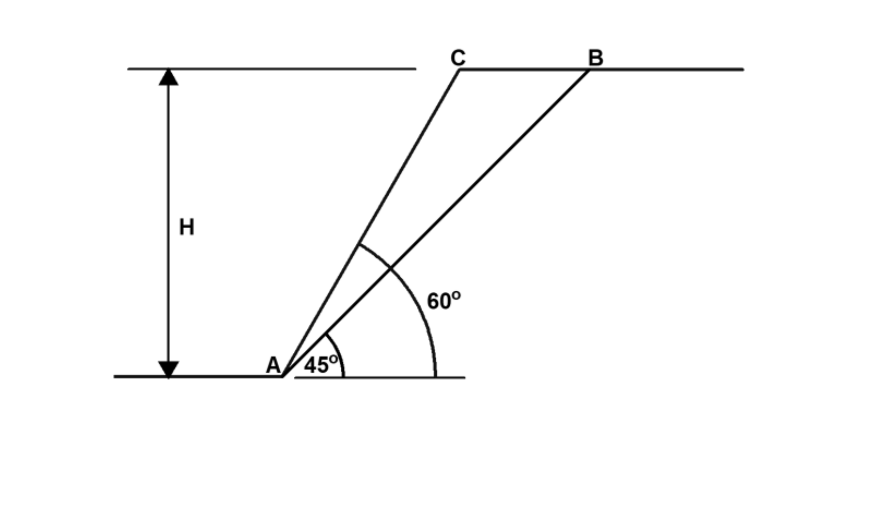

# SM-2023-2 題目正本

> 本檔只記錄**考卷上寫了什麼、圖上畫了什麼**，不含任何解法。解析見同資料夾 `SM-2023-2.md`。
> 判讀清單已確認（凍結）；本檔原則上不再修改（改動須回考卷原圖並記 log）。

| 項目 | 內容 |
|------|------|
| 考卷 | `raw/exams/SM-2023_土壤力學與基礎設計.pdf` 第 1 頁（頁次 2－1），第二題 |
| 考年 | 民國 112 年（2023） |
| 配分 | 25 分（㈠15 分、㈡10 分） |
| 附圖 | `SM-2023-2-fig-1.png`（邊坡與假設破壞面；既有截圖完整、無雜訊，沿用） |
| 判讀狀態 | **已確認**（2026-11-15 關卡一：使用者授權依建議判讀確認；轉錄 2026-11-15；PyMuPDF 110 dpi 全頁目視，附圖 500 dpi 局部放大（內嵌點陣影像）；盲讀後才比對既有解析） |

## 1. 考卷原文（逐字）

> 二、如下圖所示邊坡之高 H=8 m，土壤單位重 $\gamma$ =20 kN/m³，
> ㈠請問假設破壞面 AB 之土壤強度參數 c=50（kPa）及 $\phi$ =36°條件下之抗滑安全係數為何？（15 分）
> ㈡若考慮雨水入滲而降低假設破壞面之土壤強度參數 c=5（kPa），但仍然維持 36°，則其抗滑安全係數為何？（10 分）

## 2. 考卷給的公式、附表與參數

- 邊坡高 $H$ = 8 m；$\gamma$ = 20 kN/m³。
- 圖上：坡面 AC 傾角 60°、假設破壞面 AB 傾角 45°。
- ㈠ AB 面 $c$ = 50 kPa、$\phi$ = 36°；㈡ $c$ = 5 kPa、$\phi$ = 36°。
- **沒有給**：公式、地下水位或孔隙水壓、張力裂縫、$\gamma_w$。
- 卷首注意事項：㈠可以使用電子計算器。㈡不必抄題，作答時請將試題題號及答案依照順序寫在試卷上，於本試題上作答者，不予計分。㈢本科目除專門名詞或數理公式外，應使用本國文字作答。

## 3. 附圖

圖面文字照錄：`C`、`B`、`H`、`60°`、`A`、`45°`。

## 4. 判讀清單

| # | 項目 | 判讀 | 圖上／題文依據 | 把握 |
|---|------|------|---------------|------|
| 1 | 坡高 | $H$ = 8 m，鉛直，由坡趾地面量到坡頂面（尺寸箭頭兩端分別抵地面線與坡頂面延長線） | 附圖＋題文 | 確定 |
| 2 | 坡面 AC | 與水平夾 60°（大角弧由水平地面量到 AC） | 附圖角弧 | 確定 |
| 3 | 破壞面 AB | 平面，與水平夾 45°（小角弧由水平地面量到 AB），B 在坡頂面上、位於 C 的右側 | 附圖角弧 | 確定 |
| 4 | 地表 | 坡頂面水平（C 經 B 向右延伸）、坡趾左側地面水平 | 附圖 | 確定 |
| 5 | 滑動塊體 | 三角形楔體 ABC，沿 AB 平面滑動（二維、單位寬度） | 題文「假設破壞面 AB」＋附圖 | 確定 |
| 6 | 強度 | ㈠ $c$ = 50 kPa、$\phi$ = 36°；㈡ $c$ = 5 kPa、$\phi$ = 36°；只換 $c$，單位重不變 | 題文 | 確定 |
| 7 | ㈡的水 | 題文只說雨水入滲降低 $c$，沒有給水位或孔隙水壓 → 不另加水壓 | 題文 | 確定（解讀） |
| 8 | 考卷沒有給 | 水位、孔隙水壓、張力裂縫、坡頂超載 | 全題 | 確定 |

---

*轉錄：2026-11-15（SM-U3-3 題目正本推廣・批 1）*

*確認：2026-11-15 使用者授權依建議判讀確認（SM-U3-3 題目正本推廣・批 1，關卡一；使用者指示「要確認的依你建議」）*
