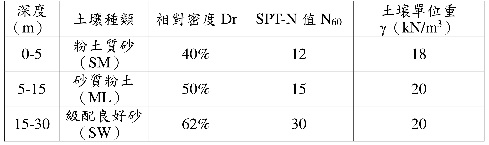

# SM-2023-3 題目正本

> 本檔只記錄**考卷上寫了什麼、圖上畫了什麼**，不含任何解法。解析見同資料夾 `SM-2023-3.md`。
> 判讀清單已確認（凍結）；本檔原則上不再修改（改動須回考卷原圖並記 log）。

| 項目 | 內容 |
|------|------|
| 考卷 | `raw/exams/SM-2023_土壤力學與基礎設計.pdf` 第 2 頁（頁次 2－2），第三題 |
| 考年 | 民國 112 年（2023） |
| 配分 | 25 分（㈠15、㈡10） |
| 附圖 | 無附圖，只有地層資料表：`SM-2023-3-fig-2.png`（表格；2026-11-15 由考卷重新擷取 500 dpi）；既有 `SM-2023-3-fig-1.png` 為同一表，左上「深度」字上有文字游標，保留不刪 |
| 判讀狀態 | **已確認**（2026-11-15 關卡一：使用者授權依建議判讀確認；轉錄 2026-11-15；PyMuPDF 110 dpi 全頁目視，表格 500 dpi 局部放大，以 PDF 文字層核對逐字原文與表格數值；盲讀後才比對既有解析） |

## 1. 考卷原文（逐字）

> 三、臺灣中南部某工業建築物基礎採用打入式鋼筋混凝土預鑄樁，樁徑為 50 公分、樁長 25 公尺。基地的地下水位在深度 10 公尺處，地層資料如下表。請參照建築物基礎構造設計規範並考慮臨界深度分析㈠樁身極限摩擦力（15 分）與㈡樁底極限支承力。（10 分）

| 深度（m） | 土壤種類 | 相對密度 Dr | SPT-N 值 N₆₀ | 土壤單位重 γ（kN/m³） |
|:---:|:---:|:---:|:---:|:---:|
| 0-5 | 粉土質砂（SM） | 40% | 12 | 18 |
| 5-15 | 砂質粉土（ML） | 50% | 15 | 20 |
| 15-30 | 級配良好砂（SW） | 62% | 30 | 20 |

## 2. 考卷給的公式、附表與參數

- 樁：打入式鋼筋混凝土預鑄樁，樁徑 50 cm、樁長 25 m。
- 地下水位：深度 10 m。
- 地層資料表（如上，三層：0–5 m SM、5–15 m ML、15–30 m SW；各層 Dr、N₆₀、γ）。
- 題目指定「參照建築物基礎構造設計規範並考慮臨界深度」（現行版見 `SM/SUBJECT.md` §7）。
- **沒有給**：各層摩擦角 φ（須由 N 值或 Dr 推估）、側向土壓力係數 K、界面摩擦角 δ、承載因數 $N_q$、臨界深度倍數、$\gamma_w$、表中 γ 在水位以下是否即飽和單位重、樁頭位置、安全係數（本題只求極限值）。
- 卷首注意事項：可以使用電子計算器。不必抄題，作答時請將試題題號及答案依照順序寫在試卷上，於本試題上作答者，不予計分。本科目除專門名詞或數理公式外，應使用本國文字作答。

## 3. 附圖

本題無附圖。地層資料表的考卷影像：

表面文字照錄：`深度（m）`、`土壤種類`、`相對密度 Dr`、`SPT-N 值 N60`、`土壤單位重 γ（kN/m3）`、`0-5`、`粉土質砂（SM）`、`40%`、`12`、`18`、`5-15`、`砂質粉土（ML）`、`50%`、`15`、`20`、`15-30`、`級配良好砂（SW）`、`62%`、`30`、`20`。

## 4. 判讀清單

| # | 項目 | 判讀 | 圖上／題文依據 | 把握 |
|---|------|------|---------------|------|
| 1 | 計算方法 | 題目要求「參照建築物基礎構造設計規範並考慮臨界深度」→ 採有效應力法（β 法）：各層 φ 由 N 值或 Dr 推估，$f_s = K\sigma'_v\tan\delta$，$\sigma'_v$ 在臨界深度以下取定值；樁底 $q_p = \sigma'_v N_q$（σ′v 同樣以臨界深度為上限）並檢核規範上限 | 題文「考慮臨界深度」；考卷未給 φ、K、δ、$N_q$ | 不確定（影響答案）；使用者授權依建議確認 |
| 2 | 表中 γ 的意義 | 每層只給一個 γ；水位（10 m）以下視同飽和單位重，有效單位重 $\gamma' = \gamma - \gamma_w$ | 表中 5–15 m 層跨越水位只有一個 γ = 20 | 確定（解讀） |
| 3 | 地層與樁底 | 0–5 m SM、5–15 m ML、15–30 m SW；樁長 25 m → 樁底在 SW 層內（深 25 m），SW 層樁段 10 m | 表格 | 確定 |
| 4 | 水位位置 | 深 10 m，在 ML 層中間 | 題文 | 確定 |
| 5 | ML 層 | 砂質粉土（ML）只給 Dr、N，不給 $s_u$ → 視為無凝聚性土，用有效應力法 | 表中只有 Dr、N、γ | 確定（解讀） |
| 6 | 樁頭位置 | 樁頂齊地表，摩擦沿全長 25 m | 題文未提樁頭高程 | 確定（解讀） |
| 7 | 樁斷面 | 直徑 0.5 m 實心圓（預鑄樁未說中空） | 題文「樁徑為 50 公分」 | 確定（解讀） |
| 8 | 規範版本 | 依專案規定用現行建築物基礎構造設計規範（112 年修正、113 年生效） | 題文；`CLAUDE.md` 規範版本 | 確定 |
| 9 | 所求 | ㈠樁身極限摩擦力（kN）；㈡樁底極限支承力（kN）；不需安全係數 | 題文 | 確定 |
| 10 | 考卷沒有給 | φ、K、δ、$N_q$、臨界深度倍數、$\gamma_w$、樁頭位置 | 全題 | 確定 |

---

*轉錄：2026-11-15（SM-U2-2 題目正本推廣・批 1）*

*確認：2026-11-15 使用者授權依建議判讀確認（SM-U2-2 題目正本推廣・批 1，關卡一；使用者指示「要我確認的請依你建議」）*
