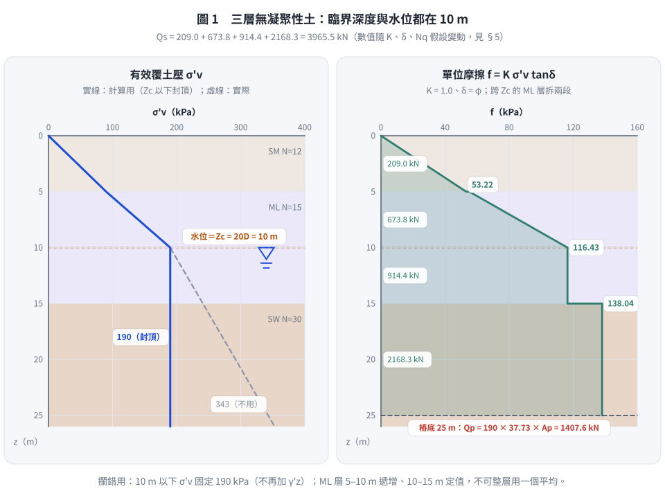

# 考題編號：SM-2023-3

**主分類：** `SM-U2-2` 深基礎之支承力與沉陷量
**副分類：** 無
**分析法：** 有效應力法
**標籤：** `打入樁` `臨界深度` `摩擦力` `端點承載力` `樁基承載力` `β法` `有效應力原理`
---

## 1. 題目（考卷原文見題目正本）

> 考卷原文、公式／附表、附圖與判讀清單（已確認）見 [`SM-2023-3-problem.md`](SM-2023-3-problem.md)。本節只列解題時最容易讀錯的地方與本解使用的記號；題意以題目正本為準。

### 常見誤讀

| 項目 | 正確判讀 | 常見誤讀 |
|---|---|---|
| 計算方法 | 有效應力法：各層 φ 由 N 值或 Dr 推估，$\sigma'_v$ 在臨界深度以下取定值，樁身摩擦與樁底都受此上限（題目正本 #1，已確認） | 只算樁身受臨界深度限制，樁底用 25 m 深的 $\sigma'_v$ |
| 表中 γ | 每層只有一個 γ；水位 10 m 以下視同飽和單位重，$\gamma'=\gamma-\gamma_w$（#2） | 水位以下仍用 γ 不扣水 |
| 樁底位置 | 樁長 25 m → 樁底在 SW 層（15–30 m）內（#3） | 樁底放在 ML 層 |
| ML 層 | 只給 Dr、N，視為無凝聚性土（#5） | 改用 α 法 |

**本解記號：** $Z_c$ 臨界深度；$\sigma'_{vc}$ 臨界深度處有效覆土壓；$K$、$\delta$ 側壓係數與界面摩擦角；$Q_s$、$Q_p$ 樁身極限摩擦力與樁底極限支承力。（地層資料為表格，不重繪，見題目正本 §1。）

## 2. 考題核心精神與出題者意圖 (Core Concepts & Examiner's Intent)
- **臨界深度觀念（Critical Depth）**：深基礎在砂土中，有效覆土壓力 $\sigma_v'$ 無法隨深度無限增加，在達到臨界深度 $Z_c$（約 $15D \sim 20D$）後，計算摩擦力與端承力所用之 $\sigma_v'$ 即視為常數。
- **參數轉換能力**：給定 SPT-N 值與相對密度 $D_r$，需具備估算土壤內摩擦角 $\phi$ 的能力。
- **地下水位影響**：精確計算地下水位上下的有效應力，特別是水位恰好在臨界深度時的應力分布。

## 3. 解題戰略地圖與陷阱分析 (Strategic Roadmap & Trap Analysis)
- **步驟 1：決定臨界深度 $Z_c$**。規範對砂土打入樁常取 $Z_c = 20D$。本題樁徑 $D=0.5$m，故 $Z_c = 10$m。
- **步驟 2：計算有效覆土壓力 $\sigma_v'$ 分布**。
  - 【陷阱 1】深度 10m 以下雖然有浮力，但因已達臨界深度，用於計算承載力的 $\sigma_v'$ 必須**維持 190 kN/m² 不變**，不可繼續隨深度增減！
  - 【陷阱 2】地下水位在 10m，10m 以上土壤為濕單位重，10m 以下為飽和單位重（本題給定單一 γ 值，故 10m 以上視為 $\gamma_t$，10m 以下計算若未達臨界深度才需扣除水重，但本題 10m 剛好為臨界深度，因此 10m 以下的承載力有效應力就是 10m 處的有效應力）。
- **步驟 3：估算內摩擦角 $\phi$ 與介面參數**。採用 $\phi = 27^\circ + 0.3 N_{60}$ 估算各層 $\phi$。設定側壓係數 $K=1.0$ 與摩擦角 $\delta = \phi$。
- **步驟 4：分層計算樁身摩擦力 $Q_s$**。因 5~15m 層跨越臨界深度，必須分為 5~10m（應力遞增）與 10~15m（應力常數）兩段計算。
- **步驟 5：計算樁底支承力 $Q_p$**。

## 3.5 變數層次分析 (Variable Hierarchy Analysis)

### 最終目標
求出該打入樁在考慮臨界深度限制下之總樁身極限摩擦力 $Q_s$ 與樁底極限支承力 $Q_p$。

### 本題關鍵公式（依計算順序）
- 判定臨界深度：$Z_c = 20D$
- 估算土壤內摩擦角：$\phi = 27^\circ + 0.3 N_{60}$
- 計算極限摩擦力：$Q_s = \sum \left( K \cdot \boxed{\bar{\sigma}_v'} \cdot \tan \delta \cdot A_s \right)$
- 計算極限端承力：$Q_p = \boxed{\sigma_{vc}'} N_q \cdot A_p$

### L1：題目直接給定
| 符號 | 數值 | 說明 |
|---|---|---|
| $D$ | 0.5 m | 樁徑 |
| $L$ | 25 m | 樁長 |
| $Z_w$ | 10 m | 地下水位深度 |

### L2：需知識點推導
**臨界深度與應力**
| 符號 | 公式／來源 | 卡關? |
|---|---|---|
| $Z_c$ | $Z_c = 20D$ | |
| $\sigma_{vc}'$ | 臨界深度處之有效覆土壓力 | |

**土壤與介面參數**
| 符號 | 公式／來源 | 卡關? |
|---|---|---|
| $\phi_i$ | $\phi = 27^\circ + 0.3 N_{60}$ | |
| $K$ | 假設打入樁 $K = 1.0$ | |
| $\delta_i$ | 假設混凝土樁 $\delta = \phi$ | |

**樁基礎承載力**
| 符號 | 公式／來源 | 卡關? |
|---|---|---|
| $Q_s$ | $Q_s = \sum f_{si} A_{si}$ | |
| $Q_p$ | $Q_p = q_p A_p = \sigma_{vc}' N_q A_p$ | |

### L3：深層知識（不懂就卡住）
| 知識點 | 說明 | 卡關? |
|---|---|---|
| 臨界深度 $\sigma_v'$ 截斷 | 深度 $> Z_c$ 後，計算摩擦力與端承力所用之有效應力不再增加，維持 $\sigma_{vc}'$。 | |
| 跨臨界深度分段 | 若某土層跨越 $Z_c$，必須將該層切分為「應力遞增區」與「應力常數區」分別計算摩擦力。 | |

## 4. 步驟化詳細計算過程 (Step-by-Step Detailed Calculation)

### Step 1: 判定臨界深度與有效覆土壓力分布
依據基礎工程學理與規範，砂土打入樁之臨界深度 $Z_c$ 約為 $15D \sim 20D$。本題取常見之 $Z_c = 20D$：
$Z_c = 20 \times 0.5 = 10 \text{ m}$

計算各深度之有效覆土壓力 $\sigma_v'$（用於計算樁承載力）：
- **$z = 0 \text{ m}$**：$\sigma_v' = 0$
- **$z = 5 \text{ m}$**：$\sigma_v' = 18 \times 5 = 90 \text{ kN/m}^2$
- **$z = 10 \text{ m}$ (臨界深度 & 水位)**：$\sigma_v' = 90 + 20 \times 5 = 190 \text{ kN/m}^2$
- **$z \ge 10 \text{ m}$**：因已達臨界深度，計算承載力所用之有效應力達上限，維持 $\sigma_{vc}' = 190 \text{ kN/m}^2$。

### Step 2: 估算各層土壤摩擦角 $\phi$ 與介面參數
利用經驗公式 $\phi = 27^\circ + 0.3 N_{60}$ 估算：
- **層1 (0~5m, SM)**：$N=12 \implies \phi_1 = 27 + 0.3(12) = 30.6^\circ$
- **層2 (5~15m, ML)**：$N=15 \implies \phi_2 = 27 + 0.3(15) = 31.5^\circ$
- **層3 (15~30m, SW)**：$N=30 \implies \phi_3 = 27 + 0.3(30) = 36.0^\circ$

依據規範，打入樁之側向土壓力係數 $K$ 可取 $1.0 \sim 2.0$。此處保守取 $K = 1.0$；樁與土壤間摩擦角 $\delta$ 對混凝土預鑄樁可取 $\delta = \phi$。

### Step 3: 計算 (一) 樁身極限摩擦力 $Q_s$
極限摩擦力公式：$f_s = K \sigma_v' \tan \delta$
因 5~15m 跨越臨界深度 10m，需分為 2a 與 2b 兩段計算：

**1. 深度 0~5m (層1)**
- 應力範圍：0 ~ 90，平均 $\bar{\sigma}_v' = 45 \text{ kN/m}^2$
- $f_{s1} = 1.0 \times 45 \times \tan(30.6^\circ) = 45 \times 0.5914 = 26.61 \text{ kN/m}^2$
- 表面積 $A_{s1} = \pi D L_1 = \pi \times 0.5 \times 5 = 7.854 \text{ m}^2$
- $Q_{s1} = 26.61 \times 7.854 = 209.0 \text{ kN}$

**2a. 深度 5~10m (層2 上半，應力遞增)**
- 應力範圍：90 ~ 190，平均 $\bar{\sigma}_v' = 140 \text{ kN/m}^2$
- $f_{s2a} = 1.0 \times 140 \times \tan(31.5^\circ) = 140 \times 0.6128 = 85.79 \text{ kN/m}^2$
- 表面積 $A_{s2a} = \pi \times 0.5 \times 5 = 7.854 \text{ m}^2$
- $Q_{s2a} = 85.79 \times 7.854 = 673.8 \text{ kN}$

**2b. 深度 10~15m (層2 下半，應力常數)**
- 有效應力維持上限：$\bar{\sigma}_v' = 190 \text{ kN/m}^2$
- $f_{s2b} = 1.0 \times 190 \times \tan(31.5^\circ) = 190 \times 0.6128 = 116.43 \text{ kN/m}^2$
- 表面積 $A_{s2b} = \pi \times 0.5 \times 5 = 7.854 \text{ m}^2$
- $Q_{s2b} = 116.43 \times 7.854 = 914.4 \text{ kN}$

**3. 深度 15~25m (層3)**
- 有效應力維持上限：$\bar{\sigma}_v' = 190 \text{ kN/m}^2$
- $f_{s3} = 1.0 \times 190 \times \tan(36.0^\circ) = 190 \times 0.7265 = 138.04 \text{ kN/m}^2$
- 表面積 $A_{s3} = \pi \times 0.5 \times 10 = 15.708 \text{ m}^2$
- $Q_{s3} = 138.04 \times 15.708 = 2168.3 \text{ kN}$

**總樁身極限摩擦力：**
$Q_s = 209.0 + 673.8 + 914.4 + 2168.3 = \boxed{3965.5 \text{ kN}}$

*(註：若依某些習慣取 K=1.5，則 Q_s = 5948.3 kN)*

*圖 1　臨界深度 $Z_c=20D$ 恰在水位，10 m 以下計算用 $\sigma'_v$ 固定 190 kPa；跨 $Z_c$ 的 ML 層拆成遞增段與定值段。攔下「10 m 以下繼續加 $\gamma' z$」與「ML 整層用一個平均應力」的錯誤。數值取本解假設（$K=1.0$、$\delta=\phi$），替代假設見 §5。*

### Step 4: 計算 (二) 樁底極限支承力 $Q_p$
樁底位於深度 25m 處 (SW 層)，土壤摩擦角 $\phi_3 = 36^\circ$。
計算端承力之有效覆土壓力為 $\sigma_{vc}' = 190 \text{ kN/m}^2$。
公式：$q_p = \sigma_{vc}' N_q$
因題目未附 Berezantzev 等深基礎承載力因素圖表，此處採用一般淺基礎之承載力公式作為推估基準（或可直接依圖表記憶值帶入）：
$N_q = e^{\pi \tan \phi} \tan^2(45^\circ + \phi/2)$
$N_q = e^{\pi \tan 36^\circ} \tan^2(45^\circ + 18^\circ) = 9.796 \times 3.852 = 37.73$
（若依據 Berezantzev 曲線，深基礎 $\phi=36^\circ$ 時 $N_q \approx 45 \sim 50$）

$q_p = 190 \times 37.73 = 7168.7 \text{ kN/m}^2$
樁底面積 $A_p = \frac{\pi}{4} D^2 = 0.19635 \text{ m}^2$
**總樁底極限支承力：**
$Q_p = q_p \cdot A_p = 7168.7 \times 0.19635 = \boxed{1407.6 \text{ kN}}$

*(註：若取 N_q=45，則 Q_p = 1678.8 kN)*

## 5. 關鍵爭議點與進階探討 (Critical Issues & Advanced Discussion)
1. **臨界深度選取**：規範對於砂土之臨界深度 $Z_c$ 並無絕對定值，多建議取 $15D \sim 20D$。本題故意將地下水位設於 10m，恰好為 $20D$，暗示採用 $Z_c = 20D$ 能簡化水下浮單位重的扣減，是極佳的切入點。
2. **經驗參數 K 與 $\delta$ 的假設**：規範僅給予範圍（$K=1.0 \sim 2.0$），未給定標準值。在國家考試中，只要有明確宣告假設條件（如本題假設 $K=1.0, \delta=\phi$），計算過程邏輯正確皆可獲得滿分。
3. **承載力因素 $N_q$**：Meyerhof 或 Berezantzev 的 $N_q$ 曲線隨 $\phi$ 變化極為劇烈。考場若未附表，寫出通用公式 $N_q = e^{\pi \tan \phi} \tan^2(45+\phi/2)$ 計算，或自行假設一個合理範圍內的值（如 40~50）並註明來源，是保障拿分的最佳策略。
4. **假設敏感度與規範依據（2026-11-15 盲解比對補註）**：考卷沒有給 φ、K、δ、$N_q$、臨界深度倍數，答案完全由假設決定，作答時逐項寫明依據即可。本解 $K=1.0$、$\delta=\phi$ 屬文獻範圍上緣（粗糙混凝土樁 $\delta/\phi$ 約 0.8～1.0）；同樣的 φ 與 $Z_c=20D$ 下，取 $\delta=0.75\phi$ 得 $Q_s\approx2804$ kN、$\delta=0.8\phi$ 得 $Q_s\approx3021$ kN。獨立盲解另以打入樁分級表（δ、$N_q$、單位摩擦與端承上限依土類與密度查表，$K=1.0$、$Z_c=20D$）得 $Q_s\approx2074$ kN、$Q_p\approx746$ kN；$Z_c$ 改取 15D、10D 時數值再降。方法（有效應力法、跨 $Z_c$ 分段、樁身與樁底都以 $\sigma'_{vc}$ 封頂）各解一致。文中「依據規範，K 可取 1.0～2.0」「δ 可取 φ」等敘述未經逐字核對現行建築物基礎構造設計規範原文，引用前請對照規範。

*修正日期：2026-11-15（§1 改為指向題目正本 `SM-2023-3-problem.md`；§5 補註假設敏感度與規範待核（盲解比對後補充，答案未變）；§4 Step 3 後 補解題圖解 figs/SM-2023-3-fig-1-critical-depth.svg；非勘誤）*
