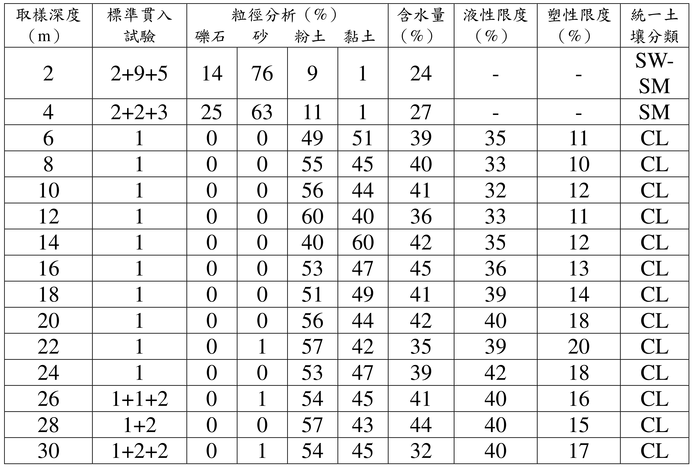

# SM-2023-4 題目正本

> 本檔只記錄**考卷上寫了什麼、圖上畫了什麼**，不含任何解法。解析見同資料夾 `SM-2023-4.md`。
> 判讀清單已確認（凍結）；本檔原則上不再修改（改動須回考卷原圖並記 log）。

| 項目 | 內容 |
|------|------|
| 考卷 | `raw/exams/SM-2023_土壤力學與基礎設計.pdf` 第 2 頁（頁次 2－2），第四題 |
| 考年 | 民國 112 年（2023） |
| 配分 | 25 分（㈠15＋㈡10） |
| 附圖 | `SM-2023-4-fig-2.png`（鑽探資料表；2026-11-15 由考卷重新擷取 500 dpi）；既有 `SM-2023-4-fig-1.png` 為同一表，左上角有滑鼠游標，保留不刪 |
| 判讀狀態 | **已確認**（2026-11-15 關卡一：使用者授權依建議判讀確認；轉錄 2026-11-15；PyMuPDF 110 dpi 全頁目視，附表 500 dpi 局部放大（向量文字）；PDF 文字層核對逐字原文；盲讀後才比對既有解析） |

## 1. 考卷原文（逐字）

> 四、某建案基地為 1000 坪（地上 12 層、地下 3 層），開挖深度 11.95 公尺，採用連續壁深度 24 公尺。進行地下工程時即有鄰近住家反映牆壁龜裂漏水、磁磚掉落等情況，建物沉陷點及建物傾斜計監測數值超過警戒值，地下開挖至第 3 層時，大底未完成即發生支撐系統失敗，造成鄰近多戶民宅嚴重傾斜下陷。工址附近鑽探資料如下表所示。㈠請研判事故發生原因（15 分）及㈡未來此區域深開挖工程災害防治可能對策。（10 分）

## 2. 考卷給的公式、附表與參數

- 基地 1000 坪、地上 12 層／地下 3 層；開挖 11.95 m、連續壁深 24 m。
- 鑽探資料表（照錄）：

| 取樣深度（m） | 標準貫入試驗 | 礫石 % | 砂 % | 粉土 % | 黏土 % | 含水量（%） | 液性限度（%） | 塑性限度（%） | 統一土壤分類 |
|---|---|---|---|---|---|---|---|---|---|
| 2 | 2+9+5 | 14 | 76 | 9 | 1 | 24 | - | - | SW-SM |
| 4 | 2+2+3 | 25 | 63 | 11 | 1 | 27 | - | - | SM |
| 6 | 1 | 0 | 0 | 49 | 51 | 39 | 35 | 11 | CL |
| 8 | 1 | 0 | 0 | 55 | 45 | 40 | 33 | 10 | CL |
| 10 | 1 | 0 | 0 | 56 | 44 | 41 | 32 | 12 | CL |
| 12 | 1 | 0 | 0 | 60 | 40 | 36 | 33 | 11 | CL |
| 14 | 1 | 0 | 0 | 40 | 60 | 42 | 35 | 12 | CL |
| 16 | 1 | 0 | 0 | 53 | 47 | 45 | 36 | 13 | CL |
| 18 | 1 | 0 | 0 | 51 | 49 | 41 | 39 | 14 | CL |
| 20 | 1 | 0 | 0 | 56 | 44 | 42 | 40 | 18 | CL |
| 22 | 1 | 0 | 1 | 57 | 42 | 35 | 39 | 20 | CL |
| 24 | 1 | 0 | 0 | 53 | 47 | 39 | 42 | 18 | CL |
| 26 | 1+1+2 | 0 | 1 | 54 | 45 | 41 | 40 | 16 | CL |
| 28 | 1+2 | 0 | 0 | 57 | 43 | 44 | 40 | 15 | CL |
| 30 | 1+2+2 | 0 | 1 | 54 | 45 | 32 | 40 | 17 | CL |

- **沒有給**：地下水位、單位重、不排水剪力強度、支撐配置、連續壁厚度、工址所在地區。
- 卷首注意事項（第 1 頁）：㈠可以使用電子計算器。㈡不必抄題，作答時請將試題題號及答案依照順序寫在試卷上，於本試題上作答者，不予計分。㈢本科目除專門名詞或數理公式外，應使用本國文字作答。

## 3. 附圖

表面文字照錄：見 §2 表格。

## 4. 判讀清單

| # | 項目 | 判讀 | 圖上／題文依據 | 把握 |
|---|------|------|---------------|------|
| 1 | 「塑性限度」欄 | 照錄數值 10～20；與液性限度 32～42 並看，數值偏小（若為塑性限度則 PI 約 20～25；若實為塑性指數則 PI 約 10～20），兩種讀法都屬 CL | 表格欄名 | 不確定（解讀；不影響說明題結論，照錄）；使用者授權依建議確認 |
| 2 | 標準貫入試驗欄 | 「2+9+5」等為每 15 cm 擊數；N 值為後兩段之和（2 m：N = 14；4 m：N = 5）；6～24 m 只寫「1」解讀為 N = 1（極軟）；26 m「1+1+2」N = 3、28 m「1+2」只列兩段（N 約 3）、30 m「1+2+2」N = 4 | 表格；SPT 慣例 | 確定（解讀） |
| 3 | 含水量與液性限度 | 6 m 以下多數深度含水量 ≥ 液性限度（液性指數 ≥ 1 左右），屬高含水量軟弱黏土 | 表格數值 | 確定 |
| 4 | 地層 | 0～約 5 m 砂質土（SW-SM、SM），6～30 m 均為軟弱 CL；連續壁底 24 m 仍在軟黏土內 | 表格 | 確定 |
| 5 | 開挖與壁深 | 開挖 11.95 m、連續壁深 24 m → 貫入約 12 m | 題文 | 確定 |
| 6 | 事故時點 | 開挖至地下第 3 層、大底未完成時支撐系統失敗；之前已有鄰房龜裂漏水、監測值超過警戒值 | 題文 | 確定 |
| 7 | 所求 | ㈠研判事故原因（說明題）、㈡此區域深開挖災害防治對策 | 題文 | 確定 |
| 8 | 考卷沒有給 | 地下水位、單位重、強度參數、支撐配置、壁厚、工址地區 | 全題 | 確定 |

---

*轉錄：2026-11-15（SM-U2-3 題目正本推廣・批 1）*

*確認：2026-11-15 使用者授權依建議判讀確認（SM-U2-3 題目正本推廣・批 1，關卡一；使用者指示「要我確認的請依你建議」）*
