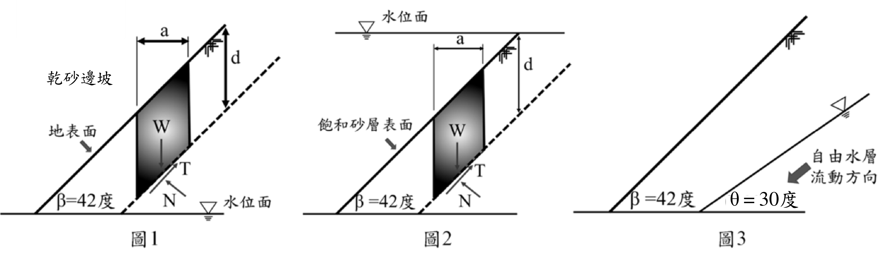

# SM-2024-2 題目正本

> 本檔只記錄**考卷上寫了什麼、圖上畫了什麼**，不含任何解法。解析見同資料夾 `SM-2024-2.md`。
> 判讀清單已確認（凍結）；本檔原則上不再修改（改動須回考卷原圖並記 log）。

| 項目 | 內容 |
|------|------|
| 考卷 | `raw/exams/SM-2024_土壤力學與基礎設計.pdf` 第 1 頁（頁次 3－1），第二題，圖 1–圖 3 |
| 考年 | 民國 113 年（2024） |
| 配分 | 25 分（㈠8 分、㈡8 分、㈢9 分） |
| 附圖 | `SM-2024-2-fig-2.png`（圖 1–圖 3；2026-11-15 由考卷重新擷取 500 dpi）；既有 `SM-2024-2-fig-1.png` 為同一圖，左下空白處有滑鼠游標，保留不刪 |
| 判讀狀態 | **已確認**（2026-11-15 關卡一：使用者授權依建議判讀確認；轉錄 2026-11-15；PyMuPDF 110 dpi 全頁目視，附圖 500 dpi 局部放大（內嵌點陣影像）；盲讀後才比對既有解析） |

## 1. 考卷原文（逐字）

> 二、砂性土壤邊坡若以無限邊坡方式分析淺層滑動，邊坡傾斜角($\beta$)42 度，土壤摩擦角($\phi$)35 度，請依圖回答下列問題：
> ㈠請計算圖 1 乾砂邊坡之安全係數。（8 分）
> ㈡邊坡若全浸於水面下，請計算如圖 2 浸水邊坡之安全係數。（8 分）
> ㈢若邊坡中有滲流的自由水層自右至左（如圖 3）並與水平夾角 $\theta$= 30 度流動，請計算自由水層之水力波降 i。（9 分）

（「水力波降」照考卷原文，即水力坡降。）

## 2. 考卷給的公式、附表與參數

- 無限邊坡、淺層滑動；$\beta$ = 42°、$\phi$ = 35°（砂性土壤）。
- 圖 3：自由水層流動方向與水平夾 $\theta$ = 30°，自右至左。
- **沒有給**：公式、凝聚力（砂性土壤）、單位重、$G_s$、$e$、$\gamma_w$、滑動深度 $d$ 與切片寬 $a$ 的數值。
- 卷首注意事項：㈠可以使用電子計算器。㈡不必抄題，作答時請將試題題號及答案依照順序寫在試卷上，於本試題上作答者，不予計分。㈢本科目除專門名詞或數理公式外，應使用本國文字作答。

## 3. 附圖

圖面文字照錄：圖 1：`a`、`d`、`乾砂邊坡`、`地表面`、`W`、`T`、`N`、`β=42度`、`水位面`、`圖1`；圖 2：`水位面`、`a`、`d`、`飽和砂層表面`、`W`、`T`、`N`、`β =42度`、`圖2`；圖 3：`自由水層`、`流動方向`、`β =42度`、`θ = 30度`、`圖3`。

## 4. 判讀清單

| # | 項目 | 判讀 | 圖上／題文依據 | 把握 |
|---|------|------|---------------|------|
| 1 | 土壤強度 | 砂性土壤，只給 $\phi$ = 35°，凝聚力取 0 | 題文「砂性土壤」 | 確定（解讀） |
| 2 | 圖 1 | 乾砂；滑動面（虛線）平行坡面；$d$ 為由地表鉛直量到滑動面的深度、$a$ 為切片水平寬；水位面在坡趾高程、整個滑動區以下，不影響滑動區 | 圖 1 尺寸線方向與水位符號位置 | 確定 |
| 3 | 圖 2 | 水位面為與坡頂同高的水平線，整個邊坡浸在靜水中（無滲流） | 圖 2＋題文「全浸於水面下」 | 確定 |
| 4 | 圖 3 自由水層 | 坡內與水平夾 $\theta$ = 30° 的斜線為自由水面（標水位符號），由坡趾右側地面起向右上；水由右上往左下沿此方向流動 | 圖 3＋題文 | 確定（解讀） |
| 5 | 圖 3 所求 | 只問自由水層的水力坡降 $i$，不問安全係數 | 題文㈢ | 確定 |
| 6 | 坡角 | 三圖皆 $\beta$ = 42° | 圖上標註 | 確定 |
| 7 | 考卷沒有給 | 單位重、$G_s$、$e$、$\gamma_w$、$d$、$a$ 的數值、凝聚力 | 全題 | 確定 |

---

*轉錄：2026-11-15（SM-U3-3 題目正本推廣・批 1）*

*確認：2026-11-15 使用者授權依建議判讀確認（SM-U3-3 題目正本推廣・批 1，關卡一；使用者指示「要確認的依你建議」）*
