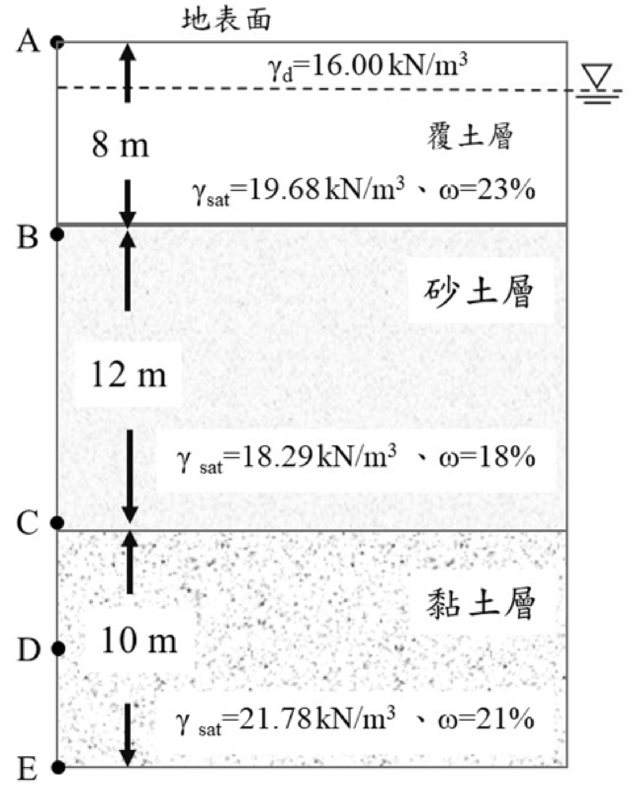

# SM-2024-3 題目正本

> 本檔只記錄**考卷上寫了什麼、圖上畫了什麼**，不含任何解法。解析見同資料夾 `SM-2024-3.md`。
> 判讀清單已確認（凍結）；本檔原則上不再修改（改動須回考卷原圖並記 log）。

| 項目 | 內容 |
|------|------|
| 考卷 | `raw/exams/SM-2024_土壤力學與基礎設計.pdf` 第 2 頁，第三題 |
| 考年 | 民國 113 年（2024） |
| 配分 | 25 分（㈠5、㈡5、㈢5、㈣10） |
| 附圖 | `SM-2024-3-fig-2.png`（土層簡化剖面；2026-11-15 由考卷重新擷取 500 dpi）；既有 `SM-2024-3-fig-1.png` 為同一圖，C 點右側（砂土層參數旁）有滑鼠游標，保留不刪 |
| 判讀狀態 | **已確認**（2026-11-15 關卡一：使用者授權依建議判讀確認；轉錄 2026-11-15；PyMuPDF 110 dpi 全頁目視並以像素量測點位，附圖 500 dpi；文字層核對；盲讀後才比對既有解析） |

## 1. 考卷原文（逐字）

> 三、鑽探後簡化之土層如下圖，分為覆土層（$\gamma_{sat}$ = 19.68 kN/m³、$\gamma_d$ = 16.00 kN/m³、飽和含水量 ω = 23%）、砂土層（$\gamma_{sat}$ = 18.29 kN/m³、飽和含水量 ω = 18%）、黏土層（$\gamma_{sat}$ = 21.78 kN/m³、飽和含水量 ω = 21%），黏土層下方為不透水層。初始地下水位在地表下 2 公尺，請問：
> ㈠若因施工降水使地下水位降至地表下 18 公尺，請問 C 點的有效應力增加或減少多少？（5 分）
> ㈡若黏土層為正常壓密黏土（e0＝0.9、壓密指數 Cc = 0.15），請問黏土層因為地下水位下降引致的壓密沉陷量是多少？（5 分）
> ㈢請問如何在土壤壓密曲線上找出預壓密應力？（5 分）
> ㈣若黏土層為過壓密黏土（e0＝0.9、Cc = 0.15、回脹指數 Cs = 0.02），其預壓密應力為 300 kPa，請問黏土層因為地下水位下降引致的壓密沉陷量是多少？（10 分）

## 2. 考卷給的公式、附表與參數

- 覆土層 8 m：$\gamma_{sat}$ = 19.68、$\gamma_d$ = 16.00 kN/m³、飽和含水量 23%。
- 砂土層 12 m：$\gamma_{sat}$ = 18.29 kN/m³、飽和含水量 18%（**沒有給 $\gamma_d$**）。
- 黏土層 10 m：$\gamma_{sat}$ = 21.78 kN/m³、飽和含水量 21%；㈡㈣ 另給 $e_0$ = 0.9、$C_c$ = 0.15，㈣ $C_s$ = 0.02、$\sigma'_p$ = 300 kPa。
- 黏土層下方為不透水層；初始地下水位地表下 2 m，降水後地表下 18 m。
- **沒有給**：$\gamma_w$；降水後水位以上土壤的單位重（砂土層的 $\gamma_d$）；$G_s$。
- 卷首注意事項：㈠可以使用電子計算器。㈡不必抄題，作答時請將試題題號及答案依照順序寫在試卷上，於本試題上作答者，不予計分。㈢本科目除專門名詞或數理公式外，應使用本國文字作答。

## 3. 附圖

圖面文字照錄：`地表面`、`A`、`γd=16.00 kN/m³`、`8 m`、`覆土層`、`γsat=19.68 kN/m³、ω=23%`、`B`、`砂土層`、`12 m`、`γsat=18.29 kN/m³ 、ω=18%`、`C`、`黏土層`、`D`、`10 m`、`γsat=21.78 kN/m³ 、ω=21%`、`E`。

## 4. 判讀清單

| # | 項目 | 判讀 | 圖上／題文依據 | 把握 |
|---|------|------|---------------|------|
| 1 | 降水後水位以上土壤的單位重 | 考卷只給覆土層 $\gamma_d$；建議降水後 2～18 m 的土改用乾單位重：覆土 $\gamma_d$ = 16.00（題給，且 16.00 × 1.23 = 19.68 與 $\gamma_{sat}$ 自洽）、砂土 $\gamma_d=18.29/1.18$ = 15.50（同法由 $\gamma_{sat}$ 與飽和含水量換算）。另一讀法為降水後仍用 $\gamma_{sat}$（毛細飽和）；C 點有效應力增量兩讀法約 107.0 對 157.0 kPa | 題文與圖給的單位重；程式重算 | 不確定（影響答案，使用者授權依建議定案：建議降水後改用乾單位重） |
| 2 | 黏土 $e_0$ 與單位重不自洽 | 由 $\gamma_{sat}$ = 21.78、$w$ = 21% 反算 $G_s\approx2.99$、$e\approx0.63$，與㈡㈣ 給的 $e_0$ = 0.9 不一致；沉陷計算照題給 $e_0$ = 0.9，單位重照題給 $\gamma_{sat}$ | 程式反算 | 確定（解讀） |
| 3 | 地層與點位 | A 地表、B 地表下 8 m（覆土底）、C 地表下 20 m（砂土底＝黏土頂）、E 地表下 30 m（黏土底）；D 在 CE 中點（地表下 25 m） | 圖左側三條尺寸線；110 dpi 像素量測 D 距 C 66 px、距 E 65 px | 確定 |
| 4 | 初始地下水位 | 地表下 2 m（題文）；圖上虛線在 A 下 26 px（AB = 102 px ↔ 8 m）→ 2.0 m，一致 | 題文、圖 | 確定 |
| 5 | 降水後水位 | 地表下 18 m，位於砂土層內（黏土頂上方 2 m） | 題文 | 確定 |
| 6 | 黏土孔隙水壓 | 長期穩態，黏土維持飽和，孔隙水壓依新水位呈靜水壓分布（下方不透水層不提供水頭） | 題文「黏土層下方為不透水層」 | 確定（解讀） |
| 7 | 沉陷計算 | 以黏土層中點 D 單層計算（10 m 厚） | 圖上特別標 D 點 | 確定（解讀） |
| 8 | ㈣ 預壓密應力 | $\sigma'_p$ = 300 kPa，視為黏土層各深度相同（以中點代表） | 題文 | 確定（解讀） |
| 9 | 考卷沒有給 | $\gamma_w$（取 9.81）、砂土 $\gamma_d$、$G_s$ | 全題 | 確定 |

---

*轉錄：2026-11-15（SM-U1-3 題目正本推廣・批 2）*

*確認：2026-11-15 使用者授權依建議判讀確認（SM-U1-3 題目正本推廣・批 2，關卡一；使用者指示「要確認的依你建議」）*
