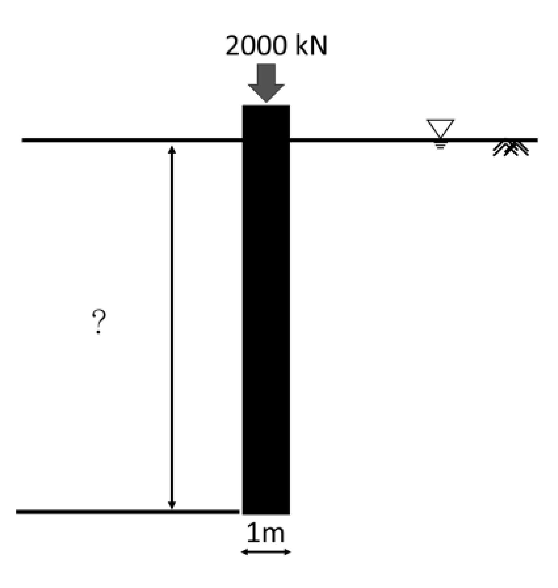

# SM-2024-4 題目正本

> 本檔只記錄**考卷上寫了什麼、圖上畫了什麼**，不含任何解法。解析見同資料夾 `SM-2024-4.md`。
> 判讀清單已確認（凍結）；本檔原則上不再修改（改動須回考卷原圖並記 log）。

| 項目 | 內容 |
|------|------|
| 考卷 | `raw/exams/SM-2024_土壤力學與基礎設計.pdf` 第 3 頁（頁次 3－3），第四題 |
| 考年 | 民國 113 年（2024） |
| 配分 | 25 分（黏土層樁長 10 分、飽和砂土層樁長 15 分） |
| 附圖 | `SM-2024-4-fig-2.png`（樁與地表剖面；2026-11-15 由考卷重新擷取 500 dpi，內嵌點陣影像 bbox (201.4, 585.8)–(393.6, 788.6)）；既有 `SM-2024-4-fig-1.png` 為同一圖，左側有滑鼠游標，保留不刪 |
| 判讀狀態 | **已確認**（2026-11-15 關卡一：使用者授權依建議判讀確認；轉錄 2026-11-15；PyMuPDF 110 dpi 全頁目視，題內公式 300 dpi、附圖 500 dpi 局部放大；盲讀後才比對既有解析） |

## 1. 考卷原文（逐字）

> 四、直徑 1 公尺的混凝土樁需承受 2000 kN 垂直載重，若安全係數為 2.5 的情況下，請計算在黏土層（飽和單位重 21 kN/m³、平均不排水剪力強度 $c_u$ = 60 kPa），與飽和砂土層（摩擦角 ϕ 為 38 度、濕土單位重 17.98 kN/m³、含水量 16%）中，需要的設計樁長分別是多少？並繪出樁身阻抗分布圖。（FS = 2.5，$N_q^*$ = 20，$N_c^*$ = 9）
> （黏土層樁長的計算占 10 分，飽和砂土層樁長的計算占 15 分，共 25 分）
> 註：
> 黏土層中：樁尖承載力 $Q_P = A_P\times c_u\times N_c^*$；樁身摩擦力 $Q_s = p\times L\times\alpha\times c_u$
> 砂土層中：臨界深度 $L_c = 15D$（砂土）；$Q_P = A_P\times q'\times N_q^*$（砂土）；
> 極限樁底阻抗 $q_l = 0.5\times p_a\times N_q^*\times\tan(\phi)$（kPa）（砂土）
> $Q_{s1(0\sim15D)} = \dfrac{1}{2}\times p\times L_c\times K_0\times\sigma'_0\times\tan(0.8\phi)$；
> $Q_{s2(>15D)} = p\times L\times K_0\times\sigma'_0\times\tan(0.8\phi)$
> 其中 D：樁直徑；Ap：樁底面積；p：樁周長；$p_a$ = 大氣壓力 ≈ 100 kPa
> （備註：請計算至小數點後兩位）
> α 值建議表（見 §2）

## 2. 考卷給的公式、附表與參數

- 樁：直徑 1 m 混凝土樁，垂直載重 2000 kN，FS = 2.5。
- 黏土層：飽和單位重 21 kN/m³、平均 $c_u$ = 60 kPa；$N_c^*$ = 9。
- 飽和砂土層：φ = 38°、濕土單位重 17.98 kN/m³、含水量 16%；$N_q^*$ = 20。
- 註中公式照錄於 §1（黏土 $Q_P$、$Q_s$；砂土 $L_c$、$Q_P$、$q_l$、$Q_{s1}$、$Q_{s2}$）；$p_a$ ≈ 100 kPa。
- α 值建議表（照錄）：

| $c_u/p_a$ | ≤0.1 | 0.2 | 0.3 | 0.4 | 0.6 | 0.8 | 1 |
|---|---|---|---|---|---|---|---|
| α | 1 | 0.92 | 0.82 | 0.74 | 0.62 | 0.54 | 0.48 |

| $c_u/p_a$ | 1.2 | 1.4 | 1.6 | 1.8 | 2 | 2.4 | 2.8 |
|---|---|---|---|---|---|---|---|
| α | 0.42 | 0.4 | 0.38 | 0.36 | 0.35 | 0.34 | 0.34 |

- **沒有給**：$K_0$ 的公式、$\gamma_w$、$G_s$、$Q_{s2}$ 式中 $L$ 與 $\sigma'_0$ 的定義文字、$q'$ 取在哪個深度、混凝土單位重（樁自重）。
- 卷首注意事項：可以使用電子計算器。不必抄題，作答時請將試題題號及答案依照順序寫在試卷上，於本試題上作答者，不予計分。本科目除專門名詞或數理公式外，應使用本國文字作答。

## 3. 附圖

圖面文字照錄：`2000 kN`、`?`、`1m`。

## 4. 判讀清單

| # | 項目 | 判讀 | 圖上／題文依據 | 把握 |
|---|------|------|---------------|------|
| 1 | 砂土有效單位重 | 題文「飽和砂土層」＋附圖水位在地表，但 17.98 與含水量 16% 描述的是**未飽和的濕土狀態**（要兩者同時是飽和狀態須 $G_s\approx2.1$，不合理）→ 由 $\gamma_d=17.98/1.16$、假設 $G_s$ = 2.65 推算 $\gamma_{sat}$ 與 $\gamma'$；把 17.98 直接當 $\gamma_{sat}$ 列為另一讀法。⚠ 待使用者複核：$G_s$ 為假設值 | 題文；附圖水位符號在地表 | 不確定（影響答案）；使用者授權依建議確認 |
| 2 | $Q_{s2}$ 式的 $L$ | 臨界深度以下的樁段長 $L - L_c$（下標「>15D」） | 公式下標 | 確定（解讀） |
| 3 | $\sigma'_0$ | 臨界深度 $L_c$ 處的有效覆土壓（$Q_{s1}$ 為三角形分布取其峰值，$Q_{s2}$ 以下維持定值） | $Q_{s1}$ 式有係數 1/2 | 確定（解讀） |
| 4 | 砂土 $q'$ | 樁底有效覆土壓，深於 $L_c$ 時取 $L_c$ 處之值；$Q_P$ 取 $A_P\times\min(q'N_q^*,\,q_l)$ | 註列 $L_c$ 後接 $Q_P$ 與「極限樁底阻抗 $q_l$」 | 確定（解讀） |
| 5 | $K_0$ | 考卷沒給公式；用 Jaky 式 $K_0 = 1-\sin\phi$ | 公式記號 $K_0$ | 確定（解讀） |
| 6 | 界面摩擦角 | $\delta = 0.8\phi$（式中 $\tan(0.8\phi)$） | 註 | 確定 |
| 7 | 黏土 α | $c_u/p_a = 60/100 = 0.6$ → 表中 α = 0.62 | α 值建議表 | 確定 |
| 8 | 所需極限承載力 | $Q_u = \text{FS}\times2000 = 5000$ kN，不計樁自重（考卷未給混凝土單位重） | 題文 | 確定（解讀） |
| 9 | 樁頂與地表 | 附圖樁頂略高出地表，樁長「?」由地表量到樁底（入土長度） | 附圖尺寸線上端對齊地表線 | 確定 |
| 10 | 地下水位 | 地表（附圖水位符號在地表線上） | 附圖 | 確定 |
| 11 | 兩情況 | 黏土層與砂土層是兩個獨立情況（整根樁分別在單一土層中），各求一個設計樁長 | 題文「在黏土層…與飽和砂土層…中…分別是多少」 | 確定 |
| 12 | 所求 | 兩種土層的設計樁長（算到小數點後兩位）＋樁身阻抗分布圖 | 題文 | 確定 |
| 13 | 考卷沒有給 | $K_0$ 公式、$\gamma_w$、$G_s$、混凝土單位重 | 全題 | 確定 |

---

*轉錄：2026-11-15（SM-U2-2 題目正本推廣・批 1）*

*確認：2026-11-15 使用者授權依建議判讀確認（SM-U2-2 題目正本推廣・批 1，關卡一；使用者指示「要我確認的請依你建議」）*
