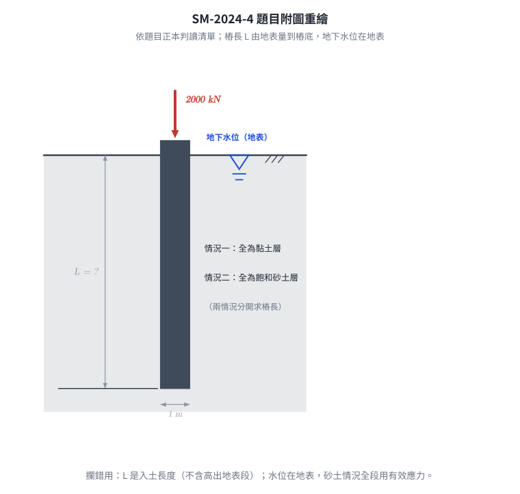
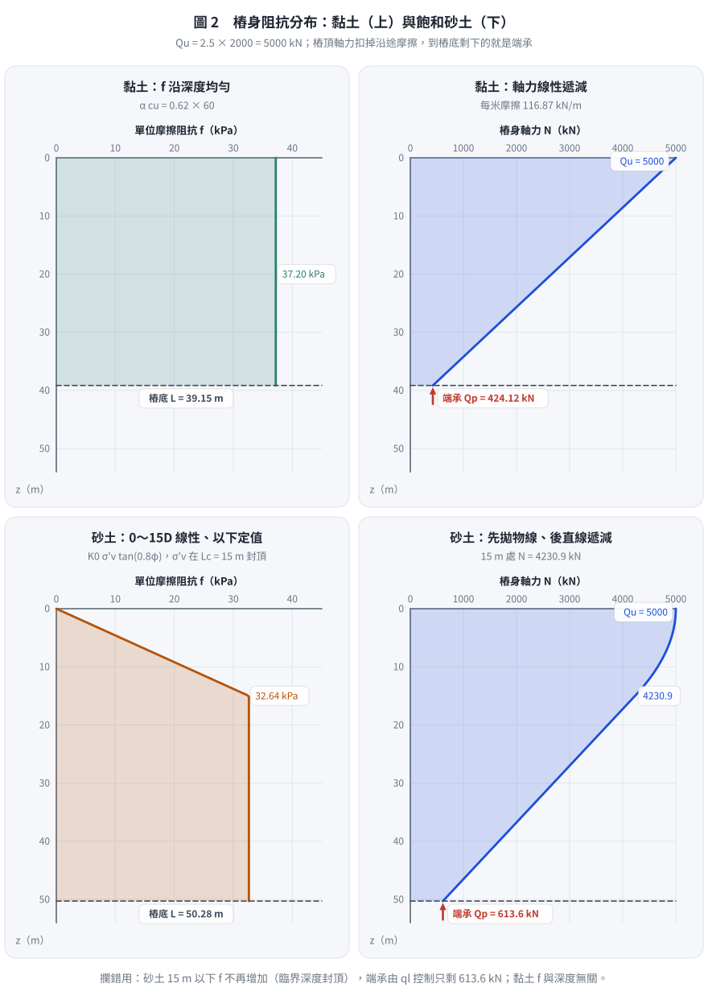

# 考題編號：SM-2024-4

**主分類：** `SM-U2-2` 深基礎之支承力與沉陷量
**副分類：** `SM-U1-1` 土壤基本性質
**分析法：** 混合
**標籤：** `樁基承載力` `α法` `臨界深度` `端點承載力` `摩擦力` `三相關係` `安全係數`
---

## 1. 題目（考卷原文見題目正本）

> 考卷原文、公式／附表、附圖與判讀清單（已確認）見 [`SM-2024-4-problem.md`](SM-2024-4-problem.md)。本節只列解題時最容易讀錯的地方與本解使用的記號；題意以題目正本為準。

*重繪自考卷附圖，依題目正本判讀清單 #9–#11；攔下的判讀錯誤：L 是入土長度，水位在地表，黏土與砂土是兩個獨立情況。*

### 常見誤讀

| 項目 | 正確判讀 | 常見誤讀 |
|---|---|---|
| 砂土單位重 | 17.98 與 16% 是未飽和濕土狀態，由 $\gamma_d=17.98/1.16$、假設 $G_s=2.65$ 推 $\gamma_{sat}$、$\gamma'$（題目正本 #1，已確認；⚠ 待使用者複核） | 直接用 $17.98-\gamma_w$ 當 $\gamma'$（樁長約 58 m） |
| $Q_{s2}$ 式的 $L$ | 臨界深度以下的樁段長 $L-L_c$；考卷式中寫 $L$（#2） | 代入全樁長 |
| $\sigma'_0$ 與 $q'$ | 取臨界深度 $L_c=15D$ 處之值；$Q_P=A_P\min(q'N_q^*,\,q_l)$（#3、#4） | 用樁底深度的 $\sigma'$，或漏檢 $q_l$ |
| $K_0$ | 考卷沒給公式，用 $1-\sin\phi$（#5） | 改用打入樁的 $K$ |

**本解記號：** $L_c=15D$ 臨界深度；$L_2=L-L_c$ 臨界深度以下樁段；$\sigma'_0$ 臨界深度處有效覆土壓；$q_l$ 極限樁底阻抗；$Q_u=2.5\times2000$ 所需極限承載力。

## 2. 考題核心精神與出題者意圖 (Core Concepts & Examiner's Intent)

本題旨在測驗考生對於**深基礎承載力**的完整計算流程，包含：
1. **總應力法 (黏土層)**：利用 $\alpha$ 法計算摩擦力，並能查表對應正確的 $\alpha$ 值。
2. **有效應力法 (砂土層)**：理解**臨界深度 (Critical Depth, $15D$)** 觀念。樁深超過 $15D$ 後，有效應力與單位摩擦力不再隨深度增加，而是保持定值；同時樁底極限阻抗也受限於 $q_l$ 上限值。
3. **土壤三相參數轉換**：給定濕土單位重與含水量，要求考生自行推算飽和單位重與有效單位重，這是大地工程計算中最經典的陷阱與基本功。

---

## 3. 解題戰略地圖與陷阱分析 (Strategic Roadmap & Trap Analysis)

**戰略地圖：**
1. **黏土層**：
   - 確認極限載重 $Q_u = Q_{all} \times FS$。
   - 計算樁端面積 $A_p$ 與周長 $p$。
   - 透過 $c_u/p_a$ 查表求得 $\alpha$。
   - 直接代入公式 $Q_u = Q_p + Q_s$ 解出樁長 $L$。
2. **飽和砂土層**：
   - **土層參數轉換**：假設 $G_s = 2.65$，由 $\gamma_m$ 及 $w$ 求得 $\gamma_d$，進而推求孔隙比 $e$ 與飽和單位重 $\gamma_{sat}$，並得到水下有效單位重 $\gamma'$。
   - **靜止土壓力係數**：採用 $K_0 = 1 - \sin\phi$。
   - **臨界深度阻抗**：計算深度 $15D$ 處的有效應力 $\sigma_{0}'$ 與單位摩擦力。
   - **樁端承載力檢核**：計算 $Q_p$，並嚴格檢核是否超過上限 $q_l \times A_p$。
   - **分段計算摩擦力**：計算 $0\sim 15D$ 區段的 $Q_{s1}$，將剩餘需要的承載力交由 $>15D$ 區段的 $Q_{s2}$ 承擔，解出下段樁長 $L_2$，最後加總得到總長。

**陷阱分析：**
- **陷阱一：濕土單位重直接當作飽和或有效單位重使用**。題目明示地層為「飽和砂土層」，且水位於地表，但給予「濕土單位重與含水量」，這意味著必須自行推算 $\gamma_{sat}$ 與 $\gamma'$，若直接把 $17.98$ 拿來扣除水重，將導致後續有效應力全錯。
- **陷阱二：忘記檢核極限樁底阻抗 $q_l$**。砂土層中 $q' N_q^*$ 往往會非常巨大，本題有特別提供 $q_l$ 上限公式，計算後會發現 $q_p$ 會被 $q_l$ 控制（封頂）。
- **陷阱三：摩擦力公式中 $K_0$ 的取值**。題目給定了含 $K_0$ 的經驗公式，一般若未特別標示，砂土的靜止土壓力係數應自行帶入 $K_0 = 1 - \sin\phi$。

---

## 3.5 變數層次分析 (Variable Hierarchy Analysis)

### 最終目標
`分別求出黏土層與飽和砂土層中，樁承受 2000 kN 載重所需之設計樁長 L`

### 本題關鍵公式（依計算順序）
【黏土層】
- 樁尖承載力：$Q_p = A_p \cdot c_u \cdot N_c^*$
- 樁身摩擦力：$Q_s = p \cdot L \cdot \boxed{\alpha} \cdot c_u$
- 長度求解：$\boxed{Q_u} = \boxed{Q_p} + \boxed{Q_s} \implies L$

【飽和砂土層】
- 砂土三相推導：$\gamma_d = \gamma_m / (1+w) \implies e = (G_s \gamma_w / \gamma_d) - 1$
- 有效單位重：$\gamma_{sat} = \gamma_w (G_s + e)/(1+e) \implies \gamma' = \boxed{\gamma_{sat}} - \gamma_w$
- 臨界深度有效應力 ($z = 15D$)：$\sigma_{0}' = \boxed{\gamma'} \cdot 15D$
- 樁尖承載力：$Q_p = A_p \cdot \min( \boxed{\sigma_{0}'} \cdot N_q^*, \boxed{q_l} )$
- 樁身上段摩擦力 ($0\sim 15D$)：$Q_{s1} = 0.5 \cdot p \cdot (15D) \cdot \boxed{K_0} \cdot \boxed{\sigma_{0}'} \cdot \tan(0.8\phi)$
- 樁身下段摩擦力 ($> 15D$)：$Q_{s2} = \boxed{Q_u} - \boxed{Q_p} - \boxed{Q_{s1}}$
- 長度求解：$\boxed{Q_{s2}} = p \cdot L_2 \cdot \boxed{K_0} \cdot \boxed{\sigma_{0}'} \cdot \tan(0.8\phi) \implies L = 15D + L_2$

### L1：題目直接給定
| 符號 | 數值 | 說明 |
|---|---|---|
| $Q_{all}$ | $2000 \text{ kN}$ | 樁承受垂直載重 |
| $FS$ | $2.5$ | 安全係數 |
| $D$ | $1 \text{ m}$ | 混凝土樁直徑 |
| $c_u$ | $60 \text{ kPa}$ | 黏土層不排水剪力強度 |
| $\gamma_m$ | $17.98 \text{ kN/m}^3$ | 砂土層濕土單位重 |
| $w$ | $16\%$ | 砂土層含水量 |
| $\phi$ | $38^\circ$ | 砂土層摩擦角 |

### L2：需知識點推導
**【幾何與極限載重】**
| 符號 | 公式／來源 | 卡關? |
|---|---|---|
| $Q_u$ | $Q_{all} \times FS$ | |
| $A_p$ | $\pi D^2 / 4$ | |
| $p$ | $\pi D$ | |

**【黏土層承載力】**
| 符號 | 公式／來源 | 卡關? |
|---|---|---|
| $\alpha$ | 由 $c_u / p_a$ 查表對應 | |

**【砂土層參數與承載力】**
| 符號 | 公式／來源 | 卡關? |
|---|---|---|
| $\gamma_{sat}, \gamma'$ | 假設 $G_s=2.65$ 及 $\gamma_w=9.81$，透過三相關係式推算 | |
| $K_0$ | $1 - \sin\phi$ | |
| $\sigma_0'$ | $\gamma' \times 15D$ | |

### L3：深層知識（不懂就卡住）
| 知識點 | 說明 | 卡關? |
|---|---|---|
| 臨界深度效應 | 砂土中樁身有效應力 $\sigma'$ 在深度超過 $15D$ 後即不再增加（保守假設），因此下段摩擦力 $f_s$ 為定值。 | |
| $q_p$ 封頂檢核 | 計算端點承載力時，必須比較 $q' N_q^*$ 與 $q_l$，取小值作為設計極限阻抗。 | |

---

## 4. 步驟化詳細計算過程 (Step-by-Step Detailed Calculation)

### Step 1：基本幾何與載重需求計算
已知樁直徑 $D = 1 \text{ m}$，要求容許載重 $Q_{all} = 2000 \text{ kN}$，安全係數 $FS = 2.5$。
極限承載力需求：
$$ Q_u = Q_{all} \times FS = 2000 \times 2.5 = 5000 \text{ kN} $$
樁底面積與樁周長：
$$ A_p = \frac{\pi}{4} D^2 = \frac{\pi}{4} (1)^2 \approx 0.7854 \text{ m}^2 $$
$$ p = \pi D = \pi(1) \approx 3.1416 \text{ m} $$

---

### Step 2：黏土層中之設計樁長計算

**1. 判定附著力係數 $\alpha$：**
大氣壓力 $p_a \approx 100 \text{ kPa}$，已知 $c_u = 60 \text{ kPa}$。
$$ \frac{c_u}{p_a} = \frac{60}{100} = 0.6 $$
查「$\alpha$ 值建議表」，當 $c_u/p_a = 0.6$ 時，可得：
$$ \alpha = 0.62 $$

**2. 計算樁尖承載力 $Q_p$：**
根據給定公式 $Q_p = A_p \times c_u \times N_c^*$，且 $N_c^* = 9$：
$$ Q_p = 0.7854 \times 60 \times 9 = 424.12 \text{ kN} $$

**3. 計算樁身摩擦力 $Q_s$ 並求解樁長 $L$：**
極限承載力為端點阻抗與樁身摩擦力之和：$Q_u = Q_p + Q_s$
$$ 5000 = 424.12 + (p \times L \times \alpha \times c_u) $$
$$ 5000 = 424.12 + (3.1416 \times L \times 0.62 \times 60) $$
$$ 4575.88 = 116.87 \times L $$
$$ L = \frac{4575.88}{116.87} \approx 39.15 \text{ m} $$

> **黏土層所需設計樁長：** $\boxed{L \approx 39.15 \text{ m}}$

---

### Step 3：飽和砂土層中之設計樁長計算

**1. 推算砂土有效單位重 $\gamma'$：**
> *策略註解：題目給定濕土單位重與含水量，代表此為實驗室測得之「自然狀態」參數，需自行轉換為現場「水下飽和狀態」之單位重。一般砂土假設比重 $G_s = 2.65$，並取水單位重 $\gamma_w = 9.81 \text{ kN/m}^3$。*

乾單位重：
$$ \gamma_d = \frac{\gamma_m}{1+w} = \frac{17.98}{1+0.16} = 15.50 \text{ kN/m}^3 $$
推求孔隙比 $e$：
$$ \gamma_d = \frac{G_s \gamma_w}{1+e} \implies 15.50 = \frac{2.65 \times 9.81}{1+e} \implies 1+e = 1.677 \implies e = 0.677 $$
飽和單位重與有效單位重：
$$ \gamma_{sat} = \frac{G_s + e}{1+e} \gamma_w = \frac{2.65 + 0.677}{1.677} \times 9.81 = 19.46 \text{ kN/m}^3 $$
$$ \gamma' = \gamma_{sat} - \gamma_w = 19.46 - 9.81 = 9.65 \text{ kN/m}^3 $$

**2. 評估臨界深度 ($L_c$) 之有效應力與單位摩擦力：**
臨界深度 $L_c = 15D = 15 \times 1 = 15 \text{ m}$。
臨界深度處之有效覆土應力：
$$ \sigma_0' = \gamma' \times 15 = 9.65 \times 15 = 144.75 \text{ kPa} $$
假設靜止土壓力係數 $K_0 = 1 - \sin\phi = 1 - \sin(38^\circ) = 0.384$。
臨界深度處之單位摩擦力上限 $f_{s,max}$：
$$ f_{s,max} = K_0 \cdot \sigma_0' \cdot \tan(0.8\phi) = 0.384 \times 144.75 \times \tan(30.4^\circ) = 55.58 \times 0.5867 = 32.61 \text{ kPa} $$
*(註：保留較多小數位 $0.38435 \times 144.75 \times 0.58670 \approx 32.64 \text{ kPa}$)*

**3. 計算樁尖承載力 $Q_p$：**
樁底極限阻抗上限：
$$ q_l = 0.5 \times p_a \times N_q^* \times \tan\phi = 0.5 \times 100 \times 20 \times \tan(38^\circ) = 1000 \times 0.7813 = 781.3 \text{ kPa} $$
假設樁長必大於 $15\text{m}$，此時樁底有效應力 $\sigma_{tip}' = \sigma_0' = 144.75 \text{ kPa}$。
依承載力公式 $q_p = \sigma_{tip}' \times N_q^* = 144.75 \times 20 = 2895 \text{ kPa}$。
因 $2895 \text{ kPa} > q_l = 781.3 \text{ kPa}$，故樁尖阻抗受上限值控制，取 $q_p = 781.3 \text{ kPa}$。
$$ Q_p = A_p \times q_p = 0.7854 \times 781.3 = 613.6 \text{ kN} $$

**4. 計算樁身摩擦力並求解樁長 $L$：**
$0 \sim 15\text{m}$ 區段之總摩擦力 $Q_{s1}$ (以 $32.64\text{ kPa}$ 計算)：
$$ Q_{s1} = \frac{1}{2} \times p \times L_c \times f_{s,max} = 0.5 \times 3.1416 \times 15 \times 32.64 = 769.1 \text{ kN} $$
需求之下段樁身摩擦力 $Q_{s2}$：
$$ Q_{s2} = Q_u - Q_p - Q_{s1} = 5000 - 613.6 - 769.1 = 3617.3 \text{ kN} $$
計算所需之下段樁長 $L_2$ ($z > 15\text{m}$ 之部分)：
$$ Q_{s2} = p \times L_2 \times f_{s,max} \implies 3617.3 = 3.1416 \times L_2 \times 32.64 = 102.54 L_2 $$
$$ L_2 = \frac{3617.3}{102.54} \approx 35.28 \text{ m} $$
總設計樁長：
$$ L = L_c + L_2 = 15 + 35.28 = 50.28 \text{ m} $$

> **飽和砂土層所需設計樁長：** $\boxed{L \approx 50.28 \text{ m}}$

---

### Step 4：樁身阻抗分布圖繪製說明

*圖 2　題目㈡要求的樁身阻抗分布圖（單位摩擦與軸力兩種畫法並列）。攔下「砂土 15D 以下 $f$ 繼續增加」與「端承漏了 $q_l$ 封頂」的錯誤；黏土 $f$ 與深度無關。*

- **黏土層之樁身阻抗分布**：
  - 阻抗隨深度呈**等值均勻分布**。
  - 數值：自地表起至深度 $39.15\text{ m}$，單位摩擦力 $f_s = \alpha c_u = 37.2\text{ kPa}$ 維持恆定。
- **飽和砂土層之樁身阻抗分布**：
  - 阻抗隨深度呈**雙折線分布**。
  - 數值：自地表 $z=0$ 起，單位摩擦力呈線性增加，至臨界深度 $z=15\text{ m}$ 時達到最大值 $f_{s,max} = 32.64\text{ kPa}$。
  - 於深度 $15\text{ m}$ 至樁底 $50.28\text{ m}$ 區間，單位摩擦力保持定值 $32.64\text{ kPa}$ 不變。

---

## 5. 關鍵爭議點與進階探討 (Critical Issues & Advanced Discussion)

1. **「濕土」參數的轉換必要性**：
   有部分考生在考場上若時間緊迫，可能會直接認定題目給的 $\gamma_m = 17.98$ 即為飽和狀態下的 $\gamma_{sat}$，並直接用 $17.98 - 9.81 = 8.17$ 作為有效單位重計算。然而，學理上「飽和砂土」搭配「含水量 16%」及「濕土」等字眼，強烈暗示這是一組需要經由 $G_s = 2.65$ 推算的考題設計。嚴謹推導 $\gamma_{sat}$ 是獲取滿分的關鍵。若以 $\gamma_{sat}=17.98$ 計算，將求出約 $58\text{ m}$ 的長度。
2. **樁尖承載力封頂 (Limiting Tip Resistance)**：
   本題設計了極小的 $q_l$ 值（僅約 $781\text{ kPa}$，遠低於砂土常見的數千 $\text{kPa}$ 承載力），目的就是要強制觸發考生的「臨界上限檢核」。若忘記比較 $q'N_q^*$ 與 $q_l$ 的大小，會導致端承載力被嚴重高估，進而算出過短的錯誤樁長。
3. **公式中 $K_0$ 的選用**：
   題目為「混凝土樁」，若是打入樁 (Driven pile)，砂土的水平側壓力會因為擠壓而上升，K 值通常大於 1.0；但公式明確指定使用符號 $K_0$，故採用靜止土壓力係數 $K_0 = 1-\sin\phi$ 是唯一且最標準的作答路徑。
4. **考卷資料彼此不一致（題目缺陷；2026-11-15 盲解比對補註）**：題文稱「飽和砂土」，但 $\gamma=17.98$、$w=16\%$ 若取 $G_s=2.65$，得 $e=0.677$、飽和度僅約 63%；若真為飽和且 $w=16\%$，則 $e=wG_s=0.424$、$\gamma_{sat}=21.18$，又與 17.98 不符。三者不可能同時成立。本解採「17.98／16% 為未飽和濕土狀態、現地在水位下飽和」並假設 $G_s=2.65$（$\gamma'=9.65$，$L$ = 50.28 m）。其他讀法：$G_s=2.70$ → 49.80 m；飽和＋$w=16\%$ 推 $\gamma'=11.37$ → 43.82 m；17.98 直接當 $\gamma_{sat}$（$\gamma'=8.17$）→ 58.03 m。作答時應寫明採用哪一種。

*修正日期：2026-11-15（§1 改為指向題目正本 `SM-2024-4-problem.md`，重繪附圖 figs/SM-2024-4-fig-1-problem.svg；§5 補註考卷資料不一致與替代值；Step 3 標題錯字「飽滿」→「飽和」（盲解比對後補充，答案未變）；§4 Step 4 補解題圖解 figs/SM-2024-4-fig-2-resistance.svg；非勘誤）*
