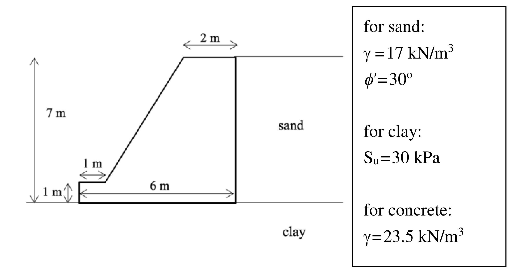

# SM-2025-3 題目正本

> 本檔只記錄**考卷上寫了什麼、圖上畫了什麼**，不含任何解法。解析見同資料夾 `SM-2025-3.md`。
> 判讀清單已確認（凍結）；本檔原則上不再修改（改動須回考卷原圖並記 log）。

| 項目 | 內容 |
|------|------|
| 考卷 | `raw/exams/SM-2025_土壤力學與基礎設計.pdf` 第 2 頁（頁次 2－2），第三題 |
| 考年 | 民國 114 年（2025） |
| 配分 | 25 分 |
| 附圖 | `SM-2025-3-fig-2.png`（擋土牆剖面＋材料參數框；2026-11-15 由考卷重新擷取 500 dpi）；既有 `SM-2025-3-fig-1.png` 為同一圖，左側空白處有滑鼠游標，保留不刪 |
| 判讀狀態 | **已確認**（2026-11-15 關卡一：使用者授權依建議判讀確認；轉錄 2026-11-15；PyMuPDF 110 dpi 全頁目視；附圖為內嵌點陣影像 598×359 px，450–500 dpi 放大；盲讀後才比對既有解析） |

## 1. 考卷原文（逐字）

> 三、請評估圖中所示之重力式擋土牆抗滑動之安全係數。（25 分）
> 附註：地表呈水平，牆背面垂直，可不考慮牆面摩擦，主動土壓力係數可用：$K_A=\tan^2\left[45^\circ-\frac{\phi}{2}\right]$

## 2. 考卷給的公式、附表與參數

- 題目印出的公式：$K_A=\tan^2\left[45^\circ-\dfrac{\phi}{2}\right]$。
- 參數框（圖右）：for sand：$\gamma$ = 17 kN/m³、$\phi'$ = 30°；for clay：$S_u$ = 30 kPa；for concrete：$\gamma$ = 23.5 kN/m³。
- 附註條件：地表水平、牆背面垂直、可不考慮牆面摩擦。
- 幾何（圖）：牆高 7 m、牆頂寬 2 m、底寬 6 m、趾部突出 1 m、趾部厚 1 m。
- **沒有給**：牆底與黏土界面的黏著係數（只給 $S_u$）、黏土單位重、安全係數要求值、地下水位、牆前覆土或被動土壓。
- 卷首注意事項：㈠可以使用電子計算器。㈡不必抄題，作答時請將試題題號及答案依照順序寫在試卷上，於本試題上作答者，不予計分。㈢本科目除專門名詞或數理公式外，應使用本國文字作答。

## 3. 附圖

圖面文字照錄：`2 m`、`7 m`、`1 m`（水平，趾部）、`1 m`（垂直，趾部厚）、`6 m`、`sand`、`clay`、`for sand: γ =17 kN/m³ φ'=30°`、`for clay: Su=30 kPa`、`for concrete: γ=23.5 kN/m³`。

## 4. 判讀清單

| # | 項目 | 判讀 | 圖上／題文依據 | 把握 |
|---|------|------|---------------|------|
| 1 | 牆底與黏土界面 | 考卷只給黏土 $S_u$ = 30 kPa，未給黏著係數。建議：短期不排水、界面黏著力取 $c_a = S_u$（係數 1.0），另以折減係數對照 | 參數框 | 不確定（影響答案）；使用者授權依建議確認 |
| 2 | 牆高 7 m | **總高**：尺寸線上箭頭在牆頂高程、下箭頭在底版底面高程（地面線），已含趾部 1 m | 450 dpi：7 m 尺寸線下端落在底面水平線上 | 確定 |
| 3 | 底寬 6 m | 由底版左緣量到牆背（底版全寬，已含趾部 1 m） | 尺寸線兩端對齊底版左緣與牆背 | 確定 |
| 4 | 趾部 | 向左突出 1 m（水平尺寸線）、厚 1 m（垂直尺寸線兩端對齊底面與趾部頂面） | 附圖 | 確定 |
| 5 | 牆頂與牆背 | 牆頂寬 2 m；牆背（右）鉛直，自牆頂到底面 | 附圖＋附註「牆背面垂直」 | 確定 |
| 6 | 前斜面 | 由趾部頂面內角斜上到牆頂左角；水平投影 6 − 1 − 2 = 3 m、高 7 − 1 = 6 m（由尺寸鏈推得，圖上未直接標） | 尺寸鏈 | 確定（解讀） |
| 7 | 附圖比例 | 垂直方向未按比例：以水平比例（底寬 6 m）換算，圖上牆高只有約 5.5 m；以標註為準 | 原影像量測 | 確定 |
| 8 | 背填砂 | 牆背後，地表水平與牆頂同高；砂層底在底版底面高程，其下為黏土；$\gamma$ = 17、$\phi'$ = 30° | 附圖＋參數框 | 確定 |
| 9 | 牆前地面 | 與底版底面同高，牆前無覆土 → 無被動抗力 | 底面高程水平線向左延伸 | 確定（解讀） |
| 10 | 牆面摩擦 | 不考慮（牆背 $\delta$ = 0） | 附註 | 確定 |
| 11 | 基礎黏土 | 牆底座落於黏土，$S_u$ = 30 kPa；黏土單位重未給 | 參數框 | 確定 |
| 12 | 所求 | 只問抗滑動安全係數 | 題文 | 確定 |
| 13 | 考卷沒有給 | 界面黏著係數、黏土單位重、安全係數要求值、地下水位（未提及，視為無水） | 全題 | 確定 |

---

*轉錄：2026-11-15（SM-U3-2 題目正本推廣・批 1）*

*確認：2026-11-15 使用者授權依建議判讀確認（SM-U3-2 題目正本推廣・批 1，關卡一；使用者指示「要確認的依你建議」）*
