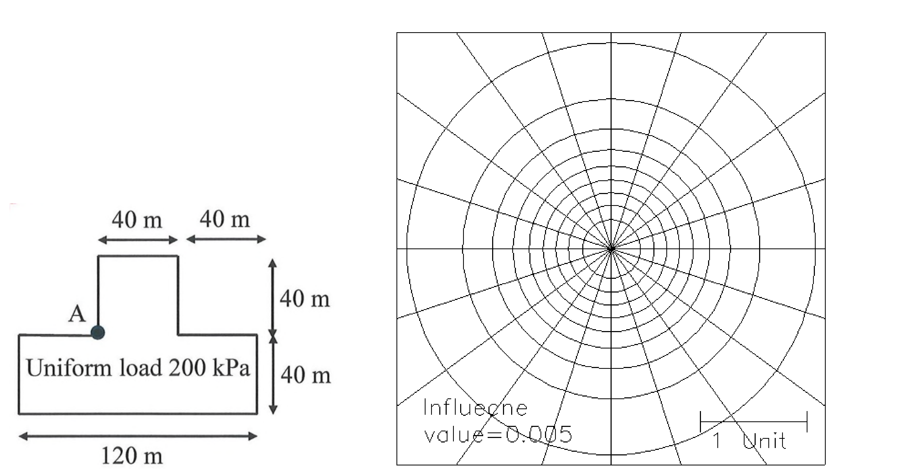

# SM-2025-4 題目正本

> 本檔只記錄**考卷上寫了什麼、圖上畫了什麼**，不含任何解法。解析見同資料夾 `SM-2025-4.md`。
> 判讀清單已確認（凍結）；本檔原則上不再修改（改動須回考卷原圖並記 log）。

| 項目 | 內容 |
|------|------|
| 考卷 | `raw/exams/SM-2025_土壤力學與基礎設計.pdf` 第 2 頁（頁次 2－2），第四題 |
| 考年 | 民國 114 年（2025） |
| 配分 | 25 分 |
| 附圖 | `SM-2025-4-fig-2.png`（T 形載重平面＋Newmark 影響圖；2026-11-15 由考卷重新擷取 500 dpi）；既有 `SM-2025-4-fig-1.png` 為同一圖，兩圖之間帶滑鼠游標，保留不刪 |
| 判讀狀態 | **已確認**（2026-11-15 關卡一：使用者授權依建議判讀確認；轉錄 2026-11-15；PyMuPDF 110 dpi 全頁目視，附圖 400 dpi 局部放大（內嵌點陣影像）；PDF 文字層核對逐字原文；盲讀後才比對既有解析） |

## 1. 考卷原文（逐字）

> 四、一均布荷重 200 kPa 透過 T 形鐵板作用在地面，如下圖所示。請估算在 A 點下方 40 m 處所受之應力增量。（25 分）

## 2. 考卷給的公式、附表與參數

- 均布荷重 200 kPa，作用面為 T 形（尺寸見 §4）。
- 附 Newmark 影響圖：圖上印 `Influecne value=0.005`（照考卷原文，Influence 拼錯）與比例尺 `1 Unit`。
- **沒有給**：Boussinesq 角隅公式或影響係數表、土壤參數（本題不需要）。
- 卷首注意事項：㈠可以使用電子計算器。㈡不必抄題，作答時請將試題題號及答案依照順序寫在試卷上，於本試題上作答者，不予計分。㈢本科目除專門名詞或數理公式外，應使用本國文字作答。

## 3. 附圖

圖面文字照錄：`40 m`、`40 m`（上方兩段水平尺寸）、`40 m`、`40 m`（右側兩段垂直尺寸）、`A`、`Uniform load 200 kPa`、`120 m`、`Influecne value=0.005`、`1 Unit`。

## 4. 判讀清單

| # | 項目 | 判讀 | 圖上／題文依據 | 把握 |
|---|------|------|---------------|------|
| 1 | 下方長方形 | 寬 120 m、高 40 m | 附圖 `120 m`、右側下段 `40 m` | 確定 |
| 2 | 上方凸出部 | 寬 40 m（上方**第一段** `40 m` 尺寸線兩端對齊凸出部左右緣）、高 40 m（右側上段） | 附圖 400 dpi：第一段箭頭兩端與凸出部左右緣同 x | 確定 |
| 3 | 凸出部位置 | 上方**第二段** `40 m` 量的是凸出部右緣到下方長方形右端；故左側缺口 = 120 − 40 − 40 = 40 m，凸出部置中 | 附圖第二段尺寸線左端在凸出部右緣、右端在長方形右端；量圖：凸出部左緣距左端 39.7 m（比例 6 px/m） | 確定 |
| 4 | A 點 | 凸出部左緣與下方長方形上緣的交點（凹角），距長方形左端 40 m、距右端 80 m | 附圖實心點位置 | 確定 |
| 5 | 所求 | A 點正下方 40 m 處的**垂直**應力增量 $\Delta\sigma_z$（題文只寫「應力增量」） | 題文 | 確定（解讀） |
| 6 | Newmark 圖 | 同心圓 9 圈（10 環）× 放射線 20 等分 = 200 格，與影響值 0.005 相符；`1 Unit` 比例尺代表深度 $z$；各圈半徑 / 1 Unit ≈ 0.27、0.40、0.52、0.64、0.77、0.92、1.11、1.40、1.92 | 附圖 400 dpi 量測 | 確定 |
| 7 | 解法 | 考卷附 Newmark 圖，但未規定必須用圖（角隅公式疊加亦可） | 題文 | 確定（解讀） |
| 8 | 考卷沒有給 | 角隅公式、影響係數表 | 全題 | 確定 |

---

*轉錄：2026-11-15（SM-U1-4 題目正本推廣・批 1）*

*確認：2026-11-15 使用者授權依建議判讀確認（SM-U1-4 題目正本推廣・批 1，關卡一；使用者指示「要我確認的請依你建議」）*
